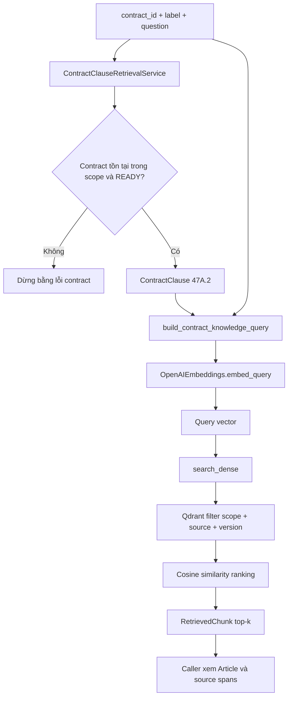
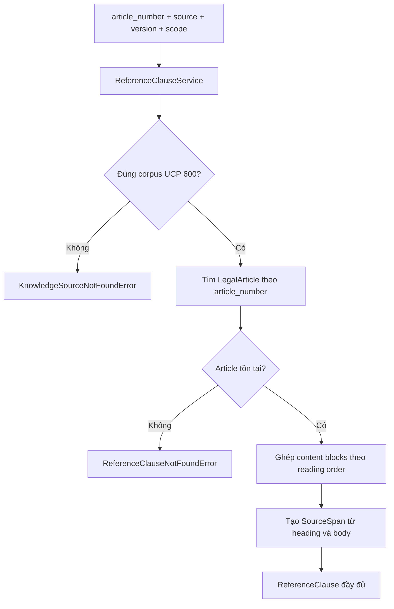

# Mốc 2 — Tìm căn cứ và đọc toàn văn UCP 600

## 1. Mục đích của tài liệu

Tài liệu này trình bày lại toàn bộ Mốc 2 của hệ thống Contract Agent dựa trên code hiện có trong repository.

Mốc 2 nhận một điều khoản hợp đồng đã được Mốc 1 xử lý, trước mắt là `LC01 / 47A.2`, rồi thực hiện hai nghiệp vụ độc lập:

1. Tìm các đoạn UCP 600 có liên quan trong Qdrant.
2. Từ số Article đã chọn, đọc toàn văn Article đó trực tiếp từ PDF UCP 600.

Mốc 2 chưa làm các việc sau:

- chưa kết luận điều khoản hợp đồng có tuân thủ UCP 600 hay không;
- chưa quyết định phí sai biệt `USD77` là đúng hay sai;
- chưa dùng ChatGPT để sinh câu trả lời;
- chưa tạo LangChain agent;
- chưa có API hoặc giao diện người dùng cho nghiệp vụ review.

Điểm kết thúc của Mốc 2 là:

> Hệ thống có thể lấy điều khoản `47A.2` từ PostgreSQL, dùng câu hỏi và nguyên văn điều khoản để tìm evidence UCP 600 có nguồn rõ ràng, sau đó đọc đầy đủ Article 16 từ PDF gốc.

---

## 2. Trạng thái đã đạt được

### 2.1. Các kết quả đã chạy thành công

- Model knowledge được tạo và validate thành công.
- Dense retrieval bắt buộc lọc đồng thời ba trường:
  - `access_scope`;
  - `source_id`;
  - `source_version`.
- Ba Qdrant payload index đã được tạo và kiểm tra:

```text
access_scope=keyword
source_id=keyword
source_version=keyword
```

- Query builder đã ghép được:
  - câu hỏi của người dùng;
  - label của contract clause;
  - title của contract clause;
  - nguyên văn contract clause.
- Corpus UCP 600 vẫn giữ đúng số lượng đã biết:

```text
39 Articles
136 paragraphs
197 items
199 chunks
```

- Reference service lấy được Article 16:

```text
source=ucp600
version=1
article=16
title=Discrepant documents, waiver and notice
page_range=6-6
source_span_count=24
```

- Live retrieval với `LC01 / 47A.2` trả về 5 kết quả.
- Article 16 xuất hiện trong các kết quả hạng 2 đến hạng 5.
- Mỗi kết quả giữ được:
  - `chunk_id`;
  - score;
  - source ID và version;
  - checksum của PDF nguồn;
  - Article;
  - structure path;
  - page range;
  - block index và `bbox`.
- Script đọc Article trả được toàn văn Article 16, trang 6, với 24 source span.

### 2.2. Giới hạn của bằng chứng hiện tại

Mốc 2 đã đạt happy path, nhưng chưa phải production-ready hoàn toàn:

- Article 16 có trong top-k nhưng Article 1 hiện đứng hạng 1. Vì vậy retrieval đã đạt tiêu chí đã chốt, nhưng ranking vẫn có thể cải thiện.
- `search_lc01_knowledge.py` chỉ kiểm tra Article 16 có xuất hiện trong tập kết quả, chưa kiểm tra Article 16 phải đứng đầu.
- Chưa chạy bộ test âm cho source, version, scope, Article không tồn tại và payload lỗi.
- Chưa chạy regression test toàn bộ RAG/API hiện tại vì đã thống nhất để dành kiểm thử tổng ở cuối hệ thống.
- Kết quả text lấy từ PDF vẫn giữ line break và dấu nối cuối dòng như `con-\nfirming`. Đây là raw source text, chưa phải bản đã normalize để hiển thị đẹp.
- Transcript đã quan sát có một đoạn hiển thị dạng code fence quanh nội dung Article 16(c)(iii)(a). Cần kiểm tra lại raw block trước khi kết luận đó là dữ liệu trong PDF hay chỉ là cách giao diện render nội dung được dán.
- Trong `qdrant_store.py`, đoạn kiểm tra cosine distance và gọi `ensure_knowledge_payload_indexes()` hiện bị lặp hai lần. Việc này chưa làm sai kết quả, nhưng nên dọn trước nghiệm thu cuối.

---

## 3. Mốc 2 nhận gì từ Mốc 1?

Mốc 2 không tự đọc lại LC01 để tách field. Nó dùng kết quả đã được Mốc 1 lưu trong PostgreSQL.

Input chính từ Mốc 1 là một `ContractClause`:

```text
contract_id=b2dbb53e-eea0-46c6-9fe5-2ed3d3578b62
label=47A.2
title=Additional Conditions item 2
raw_text=2/ DISCREPANCY FEE OF USD77 ...
page_range=3-3
source_span_count=2
```

Mốc 1 chịu trách nhiệm chứng minh câu trên thật sự đến từ LC01. Mốc 2 chỉ dùng nó như nội dung cần tra cứu căn cứ.

Mốc 2 cũng dùng một knowledge source đã được chuẩn bị trước:

```text
backend/data/raw/ucp600/UCP600.pdf
```

Tài liệu UCP 600 được biểu diễn theo hai dạng:

1. **199 chunk trong Qdrant** để tìm kiếm nhanh.
2. **Corpus đầy đủ tạo từ PDF gốc** để đọc trọn Article.

Không được dùng top-k chunk để giả lập toàn văn Article, vì top-k có thể chỉ chứa một vài đoạn rời rạc.

---

## 4. Luồng dữ liệu tổng thể

Mốc 2 có hai luồng khác nhau nhưng nối với nhau bằng `article_number`.

### 4.1. Luồng A — Tìm evidence UCP 600



Input:

```text
contract_id + label + question + trusted access_scope
```

Logic chính:

```text
lấy ContractClause
  -> ghép query text
  -> tạo embedding một lần
  -> lọc đúng knowledge source
  -> xếp hạng theo vector similarity
  -> validate payload thành RetrievedChunk
```

Output:

```text
tuple[RetrievedChunk, ...]
```

### 4.2. Luồng B — Đọc đầy đủ một Article



Input:

```text
source_id + source_version + article_number + access_scope
```

Logic chính:

```text
validate source identity
  -> tìm Article trong corpus gốc
  -> ghép body block theo thứ tự đọc
  -> tạo page range và source spans
```

Output:

```text
ReferenceClause
```

### 4.3. Mối liên hệ giữa hai luồng

```text
RetrievedChunk.article_number
  -> người gọi hoặc tầng review chọn Article cần đọc
  -> ReferenceClauseService.get_article(article_number)
  -> toàn văn Article từ PDF gốc
```

Qdrant không tự gọi Reference Clause Service. Knowledge Retrieval Service cũng không tự chọn Article cuối cùng. Trong smoke case, script chỉ xác nhận Article 16 có trong top-k; Mốc 3/4 mới là nơi điều phối việc chọn và sử dụng căn cứ để review.

---

## 5. Ai quyết định bước tiếp theo?

| Điểm quyết định | Thành phần quyết định | Quy tắc | Có dùng LLM không? |
|---|---|---|---|
| Chọn contract, label và câu hỏi | Người chạy script/operator | Truyền tham số CLI | Không |
| Người gọi có được thấy contract không | `ContractDocumentRepository` | `contract_id` và `access_scope` phải cùng khớp | Không |
| Contract có đủ điều kiện tra cứu không | `ContractClauseRetrievalService` | Trạng thái phải là `READY` | Không |
| Clause nào được dùng | `ContractClauseRetrievalService.get_by_label()` | Normalize label rồi query trong đúng contract/scope | Không |
| Nội dung nào được embed | `build_contract_knowledge_query()` | Câu hỏi + label + title + raw text | Không |
| Biến text thành vector | OpenAI embedding model | Biến đổi ngữ nghĩa thành vector số | Có model embedding, không phải answer LLM |
| Candidate nào được phép tham gia | Qdrant filter do `search_dense()` tạo | Khớp đồng thời scope/source/version | Không |
| Chunk nào đứng trước | Qdrant | Cosine similarity score giảm dần | Không |
| Bao nhiêu chunk được trả | `Settings.final_top_n` | Hiện cấu hình trả top 5 | Không |
| Có evidence hay không | Qdrant result | Service trả tuple rỗng nếu không tìm thấy | Không |
| Có được kết luận “không có quy định” không | Không thành phần nào ở Mốc 2 | Tuple rỗng không đồng nghĩa pháp luật không có quy định | Không |
| Article nào cần đọc đầy đủ | Caller/operator ở Mốc 2; agent ở Mốc sau | Dựa vào evidence đã truy xuất | Mốc 2: không |
| Source/version/scope có hợp lệ không | `ReferenceClauseService._require_source()` | Phải khớp metadata của corpus | Không |
| Article có tồn tại không | `ReferenceClauseService.get_article()` | Tra dictionary theo `article_number` | Không |
| Khi nào chuyển sang Mốc 3 | Người review | Chấp nhận phạm vi và technical debt của Mốc 2 | Không |

Điểm quan trọng: embedding model chỉ tạo vector; nó không ra quyết định pháp lý và không được xem là người kết luận compliance.

---

## 6. Thứ tự tạo/sửa file từ đầu đến cuối

Repository hiện không có Git metadata ở thư mục root để dựng lại timestamp chính xác. Bảng dưới đây ghi lại thứ tự triển khai theo kế hoạch và quá trình đã thực hiện trong cuộc hội thoại, đồng thời cũng là thứ tự phụ thuộc hợp lý để review.

| Thứ tự | File | Tạo hay sửa | Vấn đề được giải quyết |
|---:|---|---|---|
| 0 | `backend/app/rag/ingestion/source_loader.py` | Tái sử dụng | Validate UCP600 PDF và tính checksum. |
| 0 | `backend/app/rag/ingestion/pdf_extractor.py` | Tái sử dụng | Lấy text block, page và bbox từ PDF. |
| 0 | `page_cleaner.py`, `reading_order.py`, `article_parser.py`, `paragraph_parser.py`, `item_parser.py`, `chunk_builder.py` | Tái sử dụng | Chuyển PDF UCP600 thành Article/paragraph/item/chunk có traceability. |
| 0 | `backend/app/rag/embedding/openai_embedder.py` | Tái sử dụng | Tạo embedding client và vector. |
| 0 | `backend/app/contracts/clause_repository.py` và `clause_retrieval_service.py` | Tái sử dụng từ Mốc 1 | Lấy đúng contract clause từ PostgreSQL. |
| 1 | `backend/app/rag/models.py` | Sửa | Bổ sung dữ liệu nguồn còn thiếu cho `RetrievedChunk` và tạo `ReferenceClause`. |
| 2 | `backend/app/rag/retrieval/dense_retriever.py` | Sửa | Bắt buộc lọc scope/source/version và chuyển Qdrant payload thành model an toàn. |
| 3 | `backend/app/rag/vector_store/qdrant_store.py` | Sửa | Tạo/kiểm tra ba keyword payload index và hợp nhất trách nhiệm collection. |
| 4 | `backend/scripts/knowledge/ensure_ucp600_indexes.py` | Tạo | Chỉ bổ sung/check index, không embed lại 199 chunk. |
| 5 | `backend/app/knowledge/retrieval_service.py` | Tạo | Điều phối query text → embedding → dense retrieval. |
| 6 | `backend/app/rag/ingestion/ucp600_corpus.py` | Tạo/di chuyển logic dùng chung | Cho application code chuẩn bị corpus UCP600 mà không phụ thuộc script. |
| 7 | `backend/scripts/rag_pipeline/common.py` | Sửa | Re-export corpus API để các script cũ tiếp tục chạy. |
| 8 | `backend/app/knowledge/reference_service.py` | Tạo | Lấy toàn văn Article từ corpus gốc và trả source spans. |
| 9 | `backend/app/knowledge/__init__.py` | Tạo/sửa | Cung cấp public imports ổn định cho knowledge package. |
| 10 | `backend/scripts/knowledge/search_lc01_knowledge.py` | Tạo | Smoke luồng PostgreSQL → embedding → Qdrant với LC01/47A.2. |
| 11 | `backend/scripts/knowledge/get_ucp600_article.py` | Tạo | Smoke lấy toàn văn Article theo số. |
| 12 | `backend/scripts/knowledge/__init__.py` | Tạo | Cho phép chạy script bằng `python -m scripts.knowledge...`. |
| 13 | `backend/requirements.txt` | Sửa | Pin `qdrant-client>=1.20,<1.21` để dùng API `query_points()` thống nhất trong container. |

Lý do thứ tự này quan trọng:

- Model phải có trước thì retriever mới biết output hợp lệ trông như thế nào.
- Filter phải có trước thì index mới biết field nào cần tối ưu.
- Index script phải tách khỏi re-index script để không tốn tiền embedding lại.
- Retrieval service cần cả embedding client và dense retriever.
- Reference service cần corpus đã được chuyển khỏi tầng script sang application package.
- Smoke script chỉ nên tạo sau khi public service đã ổn định.

---

## 7. Package và import được dùng để làm gì?

### 7.1. Package bên ngoài

| Package/import | File dùng chính | Tác dụng | Vì sao chọn |
|---|---|---|---|
| `pydantic.BaseModel` | `rag/models.py` | Tạo typed model cho chunk, span và reference clause | Reject payload thiếu/sai ngay khi đi qua boundary. |
| `pydantic.Field` | `rag/models.py`, `core/config.py` | Khai báo min/max, regex, số dương | Invariant nằm cạnh dữ liệu thay vì rải trong service. |
| `pydantic.model_validator` | `rag/models.py` | So page range với các source span | Không cho citation nói trang 6 nhưng span lại ở trang khác. |
| `langchain_openai.OpenAIEmbeddings` | `openai_embedder.py`, `retrieval_service.py` | Biến query/chunk thành vector | Dùng cùng embedding family giữa index và query. |
| `qdrant_client.QdrantClient` | retriever và vector store | Kết nối collection, query và tạo index | Qdrant là vector database đã dùng trong hệ thống. |
| `qdrant_client.models.Filter` | `dense_retriever.py` | Gom điều kiện lọc payload | Một query chỉ được search trong đúng source được phép. |
| `FieldCondition` | `dense_retriever.py` | Mô tả điều kiện cho một field | Tạo riêng condition cho scope/source/version. |
| `MatchValue` | `dense_retriever.py` | Yêu cầu keyword khớp chính xác | Version và scope không được tìm gần đúng. |
| `PayloadSchemaType.KEYWORD` | `qdrant_store.py` | Kiểu index cho string exact-match | Phù hợp với filter identity/access. |
| `VectorParams`, `Distance.COSINE` | `qdrant_store.py` | Định nghĩa vector size và metric | Embedding retrieval đang dùng cosine similarity. |
| SQLAlchemy `Session`, `select`, `selectinload` | contract repository/service | Lấy clause và eager-load spans/blocks/pages | Ngăn N+1 query và giữ đầy đủ vị trí PDF. |
| `pymupdf` | `pdf_extractor.py` | Lấy positioned text block từ UCP600 PDF | Cần bbox, plain-text extractor không đủ. |

`qdrant-client` được pin `>=1.20,<1.21` vì code hiện dùng API:

```python
client.query_points(...)
query_response.points
```

Lỗi đã gặp trước khi sửa là:

```text
AttributeError: 'QdrantClient' object has no attribute 'search'
```

Nguyên nhân là code dùng API cũ `client.search()` nhưng container cài client mới. Quyết định sửa code theo API đang cài và pin version giúp local/container không trôi khác nhau.

### 7.2. Python standard library

| Import | Dùng để làm gì? |
|---|---|
| `from __future__ import annotations` | Cho phép type annotation tham chiếu class định nghĩa phía sau, ví dụ `SourceSpan`. |
| `collections.abc.Sequence` | Chấp nhận query vector dạng sequence thay vì khóa vào list. |
| `math.isfinite` | Reject `NaN`, `inf`, `-inf` trước khi gửi vector. |
| `dataclasses.dataclass` | Tạo `PreparedCorpus` bất biến, nhẹ và rõ thành phần. |
| `pathlib.Path` | Tạo đường dẫn `UCP600.pdf` không phụ thuộc thư mục shell hiện tại. |
| `argparse.ArgumentParser` | Parse và validate input command line của smoke script. |
| `uuid.UUID` | Chuyển `contract_id` CLI thành UUID đúng type. |
| `uuid.uuid5`, `NAMESPACE_URL` | Tạo Qdrant point ID ổn định từ `chunk_id`. |
| `hashlib.sha256` | Checksum PDF và stable chunk identity. |
| `re` | Nhận Article, paragraph và Roman item trong PDF. |
| `collections.Counter` | Tìm header/footer lặp trên nhiều trang. |
| `functools.lru_cache` | Cache `Settings` trong một process. |

### 7.3. Import nội bộ

Import nội bộ không cài thêm package. Chúng thể hiện dependency giữa các lớp:

| Import | Ý nghĩa kiến trúc |
|---|---|
| `app.contracts.models.ContractClause` | Knowledge service nhận domain object từ Mốc 1, không nhận row SQL thô. |
| `app.core.config.Settings` | Service nhận cấu hình đã validate, không tự đọc `.env` rải rác. |
| `app.rag.models.RetrievedChunk` | Dense retriever phải trả đúng output contract chung. |
| `app.rag.models.ReferenceClause` | Full Article có type riêng, không giả làm search chunk. |
| `create_embedding_client` | Gom việc khởi tạo OpenAI embedding ở một nơi. |
| `create_qdrant_client` | Gom URL/key/timeout Qdrant ở một nơi. |
| `search_dense` | Tách logic truy vấn vector khỏi orchestration business. |
| `prepare_ucp600_corpus` | Reference service dùng cùng parser chuẩn với ingestion pipeline. |

---

## 8. Review từng file theo Input → Logic → Output

### 8.1. `backend/app/rag/models.py`

#### Vấn đề giải quyết

Qdrant payload trước đó đã có checksum, source spans và parent chunk ID, nhưng `RetrievedChunk` cũ không giữ đầy đủ chúng. Khi model bỏ dữ liệu, tầng review không thể highlight hoặc chứng minh evidence nằm ở đâu.

#### Phần được thêm cho Mốc 2

`RetrievedChunk` giữ:

```text
chunk_id
source_id
source_version
source_checksum_sha256
text
article_number
structure_path
page_start/page_end
source_spans
parent_chunk_id
access_scope
score
```

`ReferenceClause` giữ:

```text
source identity/version/checksum
article number/title/raw text
page range/source spans
access scope
```

#### Input

- Qdrant payload + score cho `RetrievedChunk`.
- `LegalArticle` + `SourceDocument` metadata cho `ReferenceClause`.

#### Logic

- Validate checksum là 64 ký tự hex.
- Article chỉ từ 1 đến 39.
- Phải có ít nhất một source span.
- `page_start` và `page_end` phải khớp min/max page của spans.

#### Output

- Domain object an toàn, có thể dùng làm evidence/citation.

#### Lý do dùng lại `SourceSpan`

Hệ thống chỉ cần một kiểu vị trí cho knowledge PDF:

```text
page_number + block_index + bbox
```

Nếu tạo thêm kiểu tọa độ thứ hai, retrieval và full Article có thể diễn giải vị trí khác nhau.

---

### 8.2. `backend/app/rag/retrieval/dense_retriever.py`

#### Vấn đề giải quyết

Vector similarity không tự bảo vệ scope. Nếu chỉ gửi query vector mà không filter, kết quả có thể đến từ tài liệu hoặc version khác.

#### Input

```text
QdrantClient
collection_name
query_vector
access_scope
source_id
source_version
limit
expected_dimensions
```

#### Logic

1. Trim và reject scope/source/version rỗng.
2. Reject `limit <= 0`.
3. Kiểm tra chiều vector đúng cấu hình.
4. Reject vector có `NaN` hoặc infinity.
5. Tạo Qdrant `Filter(must=[...])` cho cả ba field.
6. Gọi `client.query_points()`.
7. Yêu cầu payload nhưng không tải lại stored vectors.
8. Với từng point, ghép payload và score rồi validate thành `RetrievedChunk`.

#### Output

```python
tuple[RetrievedChunk, ...]
```

Tuple rỗng là kết quả hợp lệ nếu không tìm thấy evidence. Service không tự diễn giải nó thành “UCP 600 không có quy định”.

#### Ai quyết định ranking?

Qdrant xếp hạng theo cosine score. Python service quyết định candidate nào được phép tham gia bằng filter, nhưng không sửa score.

---

### 8.3. `backend/app/rag/vector_store/qdrant_store.py`

#### Vấn đề giải quyết

Qdrant cần collection đúng vector size/distance và payload index cho các field được dùng để filter.

#### Import chính

- `QdrantClient`: client thao tác Qdrant.
- `Distance`: chọn cosine distance.
- `VectorParams`: khai báo vector schema.
- `PayloadSchemaType`: khai báo keyword index.
- `PointStruct`: đóng gói point ID, vector và payload.
- `uuid5`: biến stable `chunk_id` thành UUID hợp lệ với Qdrant.
- `Settings`: lấy URL/key/collection config mà không hard-code.

#### Input

- Settings để tạo client.
- `DocumentChunk` và vector để tạo point.
- Collection name và field cần index.

#### Logic

- `create_qdrant_client()` tạo client bằng secret trong settings.
- `_create_point()` giữ toàn bộ traceability trong payload.
- `upsert_chunks()` upload theo batch và yêu cầu server xác nhận bằng `wait=True`.
- `ensure_payload_index()` tạo index nếu thiếu, hoặc reject nếu index có sai type.
- `ensure_collection()` tạo/validate collection rồi đảm bảo knowledge indexes.
- `ensure_knowledge_payload_indexes()` tạo ba keyword index bắt buộc.

#### Output

- Qdrant collection có vector schema phù hợp.
- Mỗi point có vector và payload đầy đủ.
- Ba exact-match indexes tồn tại.

#### Vì sao script Mốc 2 không gọi `upsert_chunks()`?

199 chunks đã có trong collection. Mốc 2 chỉ thêm index cho payload hiện hữu. Re-embed sẽ tốn API call, thời gian và có thể làm thay đổi vector không cần thiết.

#### Technical debt hiện tại

Trong `ensure_collection()`, hai đoạn sau đang xuất hiện hai lần:

```python
if vector_config.distance != Distance.COSINE:
    ...

ensure_knowledge_payload_indexes(...)
```

Cần xóa bản lặp ở lần dọn code kế tiếp. Đây là thao tác idempotent nên chưa phá kết quả hiện tại.

---

### 8.4. `backend/scripts/knowledge/ensure_ucp600_indexes.py`

#### Vấn đề giải quyết

Cần một entry point chỉ tạo/kiểm tra payload index mà không chạy lại parser, embedding và upsert.

#### Input

- Qdrant settings từ environment.
- Collection name trong `Settings`.

#### Logic

1. Tạo Qdrant client.
2. Gọi `ensure_knowledge_payload_indexes()`.
3. Đọc lại collection schema.
4. Kiểm tra đủ ba field.
5. In tên field và data type, không in API key.
6. Luôn đóng client trong `finally`.

#### Output

```text
Knowledge payload indexes passed
access_scope=keyword
source_id=keyword
source_version=keyword
```

#### Ai quyết định bước tiếp?

Script chỉ pass nếu server đọc lại được cả ba index. Người vận hành nhìn output pass rồi mới chuyển sang tạo retrieval service.

---

### 8.5. `backend/app/knowledge/retrieval_service.py`

#### Vấn đề giải quyết

Dense retriever chỉ biết search một vector. Nghiệp vụ cần biết cách biến câu hỏi và contract clause thành query vector phù hợp.

#### Import chính

- `OpenAIEmbeddings`: type của dependency embedding.
- `QdrantClient`: type của dependency vector database.
- `ContractClause`: input domain từ Mốc 1.
- `Settings`: collection, dimensions và top-n.
- `create_embedding_client`: factory tạo embedding client thật.
- `RetrievedChunk`: output domain.
- `search_dense`: thực hiện filtered vector search.
- `create_qdrant_client`: factory tạo Qdrant client thật.

#### Input public

```python
search_contract_clause(
    question: str,
    clause: ContractClause,
    access_scope: str,
    source_id: str = "ucp600",
    source_version: str = "1",
) -> tuple[RetrievedChunk, ...]
```

#### Logic

`build_contract_knowledge_query()` tạo text:

```text
User question:
What UCP 600 provision governs refusal due to discrepancies?

Contract clause:
Label: 47A.2
Title: Additional Conditions item 2
Text:
2/ DISCREPANCY FEE OF USD77 ...
```

Sau đó service:

1. Validate scope/source/version.
2. Build query text.
3. Gọi `embed_query()` đúng một lần.
4. Gọi `search_dense()` với collection và `final_top_n` từ settings.
5. Trả nguyên thứ tự score của Qdrant.

#### Output

```python
tuple[RetrievedChunk, ...]
```

#### Vì sao dùng cả question và raw clause?

- Question cho biết mục tiêu cần tra, ví dụ refusal due to discrepancies.
- Raw clause giữ thuật ngữ thực tế của LC, ví dụ discrepancy fee và discrepant documents.

Nếu chỉ dùng question, query có thể mất dữ kiện cụ thể của hợp đồng. Nếu chỉ dùng clause, retrieval có thể không hiểu mục tiêu pháp lý mà người dùng đang hỏi.

#### Vì sao dependency được truyền vào constructor?

`KnowledgeRetrievalService` nhận embedding client và Qdrant client thay vì tự tạo chúng trong mỗi method. Điều này:

- tránh mở client lại mỗi lần gọi;
- cho phép thay bằng fake khi test;
- làm rõ service sở hữu dependency nào;
- cho phép `close()` đóng Qdrant client.

---

### 8.6. `backend/app/rag/ingestion/ucp600_corpus.py`

#### Vấn đề giải quyết

Logic chuẩn bị UCP600 trước đây nằm ở tầng script. `ReferenceClauseService` là application code, vì vậy không nên import ngược từ `scripts`.

#### `PreparedCorpus` chứa gì?

```text
source: SourceDocument
articles: tuple[LegalArticle, ...]
paragraphs: tuple[LegalParagraph, ...]
items: tuple[LegalItem, ...]
chunks: tuple[DocumentChunk, ...]
```

`@dataclass(frozen=True)` được chọn vì đây là một bundle dữ liệu sau khi chuẩn bị xong, không nên bị mutate tùy ý.

#### Input

- `Settings` để lấy `max_chunk_characters`.
- `pdf_path`, mặc định là `backend/data/raw/ucp600/UCP600.pdf`.

#### Logic theo từng import

| Hàm import | Input | Logic | Output |
|---|---|---|---|
| `create_source_document` | PDF path + source/version/scope | Validate PDF, tính SHA-256 | `SourceDocument` |
| `extract_pdf_pages` | PDF path | PyMuPDF lấy block và bbox | `tuple[ExtractedPage]` |
| `remove_repeated_margin_blocks` | extracted pages | Loại header/footer lặp | cleaned pages |
| `order_two_column_pages` | cleaned pages | Đọc cột trái trước, cột phải sau | ordered pages |
| `parse_ucp600_articles` | ordered pages | Nhận heading Article 1–39 | 39 `LegalArticle` |
| `parse_ucp600_paragraphs` | articles | Tách paragraph a, b, c... | 136 `LegalParagraph` |
| `parse_ucp600_items` | paragraphs | Tách Roman item i, ii, iii... | 197 `LegalItem` |
| `build_document_chunks` | source + articles + items | Nhóm nguyên block, tạo ID/path/spans | 199 `DocumentChunk` |

#### Output

```python
PreparedCorpus
```

#### Ai quyết định bước tiếp?

Hàm chạy tuần tự. Mỗi parser validate invariant của tầng mình. Nếu Article không đủ 1–39 hoặc block/source mapping lỗi, exception dừng pipeline; bước sau không được chạy.

---

### 8.7. `backend/scripts/rag_pipeline/common.py`

#### Vấn đề giải quyết

Các script Stage 01–05 cũ đang import `prepare_ucp600_corpus` từ `scripts.rag_pipeline.common`. Sau khi chuyển implementation thật vào `app`, cần giữ import path cũ để không phá script đang hoạt động.

#### Input/logic/output

- Không có business logic mới.
- Import và re-export:
  - `DEFAULT_PDF_PATH`;
  - `PreparedCorpus`;
  - `prepare_ucp600_corpus`.

Đây là compatibility layer, không phải một bản corpus implementation thứ hai.

---

### 8.8. `backend/app/knowledge/reference_service.py`

#### Vấn đề giải quyết

Search chunk chỉ là đoạn evidence. Review cần toàn văn Article để không bỏ sót điều kiện ở đầu hoặc cuối Article.

#### Import chính

- `Settings`: factory cần config parser.
- `PreparedCorpus`, `prepare_ucp600_corpus`: nguồn dữ liệu đầy đủ từ PDF.
- `LegalArticle`: article đã parse theo reading order.
- `ReferenceClause`: output public.
- `SourceSpan`: chuyển source blocks thành citation locations.

#### Input public

```python
get_article(
    source_id: str,
    source_version: str,
    article_number: int,
    access_scope: str,
) -> ReferenceClause
```

#### Logic

1. Constructor tạo dictionary `article_number -> LegalArticle` để lookup nhanh.
2. `_require_source()` normalize và validate source/version/scope.
3. Nếu identity không khớp corpus, ném `KnowledgeSourceNotFoundError`.
4. Lookup Article theo số.
5. Nếu không tồn tại, ném `ReferenceClauseNotFoundError`.
6. `_build_source_spans()` ghép heading và body blocks đúng thứ tự.
7. Reject duplicate `(page_number, block_index)`.
8. Dùng `article.text` để lấy body đầy đủ.
9. Trả `ReferenceClause` cùng checksum và page range.

#### Output

Một `ReferenceClause` đầy đủ, ví dụ Article 16 có:

```text
title=Discrepant documents, waiver and notice
page_range=6-6
source_span_count=24
```

#### Vì sao đọc lại từ corpus thay vì nối các chunk Qdrant?

- Top-k không bảo đảm trả đủ mọi đoạn của Article.
- Chunk có thể bị chia thành nhiều part.
- Một chunk có score thấp vẫn có thể là điều kiện pháp lý quan trọng.
- Corpus gốc giữ reading order và toàn bộ source spans.

---

### 8.9. `backend/app/knowledge/__init__.py`

#### Vấn đề giải quyết

Caller không nên biết service nằm ở file nội bộ nào. Package cần một public API ổn định.

#### Logic

Re-export:

- retrieval service và factory;
- query builder;
- reference service và factory;
- hai exception phân biệt source không có và Article không có.

`__all__` ghi rõ symbol nào được xem là public.

#### Output

Caller có thể viết:

```python
from app.knowledge import (
    create_knowledge_retrieval_service,
    create_ucp600_reference_service,
)
```

thay vì phụ thuộc trực tiếp vào cấu trúc file bên trong.

---

### 8.10. `backend/scripts/knowledge/search_lc01_knowledge.py`

#### Vấn đề giải quyết

Cần chứng minh luồng thật chạy xuyên qua PostgreSQL, OpenAI embedding và Qdrant bằng LC01.

#### Input CLI

```text
contract_id
label
question
```

`argparse` chuyển contract ID thành `UUID`, nên input sai format bị dừng trước khi query database.

#### Logic

1. Đọc settings.
2. Tạo SQLAlchemy engine và session factory.
3. Dùng `ContractClauseRetrievalService` lấy clause trong scope `public`.
4. Đóng database session sau khi domain clause đã được tạo.
5. Tạo `KnowledgeRetrievalService`.
6. Search đúng `ucp600`, version `1`, scope `public`.
7. Reject nếu không có result.
8. Kiểm tra Article 16 có trong tập Article trả về.
9. In từng result cùng score và source spans.
10. Luôn đóng knowledge service và dispose engine.

#### Output

Output dành cho operator review, không phải API response:

```text
result_count=5
article_numbers=[1, 16]
```

Sau đó là 5 result với đầy đủ text, score, checksum, Article, page và bbox.

#### Ý nghĩa của kết quả hiện tại

- Pass: Article 16 đã được tìm thấy.
- Chưa tối ưu: Article 1 đứng hạng 1, Article 16 đứng hạng 2–5.
- Chưa có kết luận compliance: evidence retrieval không nói phí USD77 hợp lệ hay không.

---

### 8.11. `backend/scripts/knowledge/get_ucp600_article.py`

#### Vấn đề giải quyết

Cần một smoke script độc lập với Qdrant để chứng minh có thể đọc toàn văn một Article từ PDF/corpus.

#### Input CLI

```text
article_number
```

#### Logic

1. `argparse` parse số Article.
2. Tạo `ReferenceClauseService` từ corpus UCP600.
3. Gọi `get_article()` với trusted constants của smoke case.
4. In source metadata, title, page range, raw text và từng span.

#### Output

```text
UCP 600 reference clause passed
article_number=16
page_range=6-6
source_span_count=24
```

Script này không dùng OpenAI và không search Qdrant.

---

### 8.12. `backend/requirements.txt`

#### Vấn đề giải quyết trong Mốc 2

Local code và Docker container phải dùng cùng Qdrant API generation.

#### Thay đổi liên quan

```text
qdrant-client>=1.20,<1.21
```

#### Input → logic → output

- Input: version constraint.
- Logic: `pip` chọn một release tương thích trong nhánh 1.20.
- Output: có `query_points()` và response `.points` như code đang dùng.

Pin minor range không loại bỏ hoàn toàn nhu cầu test, nhưng ngăn tự động nhảy sang một major/minor API chưa được xác nhận.

---

## 9. Dữ liệu thay đổi hình dạng như thế nào?

### 9.1. Contract side

```text
PostgreSQL records
  ContractClauseRecord
  ContractClauseSpanRecord
  ContractTextBlockRecord
  ContractPageRecord
        |
        v
ContractClauseRepository.to_domain()
        |
        v
ContractClause
  raw_text
  page range
  contract source spans
```

### 9.2. Query side

```text
question + ContractClause
        |
        v
multiline query text
        |
        v
embedding vector[1536]
        |
        v
Qdrant query + exact filters
```

Số chiều thực tế lấy từ `Settings.embedding_dimensions`, mặc định hiện là 1536. Code không hard-code 1536 trong retriever; nó so với settings.

### 9.3. Evidence side

```text
Qdrant ScoredPoint
  id
  score
  payload dict
        |
        v
RetrievedChunk.model_validate(...)
        |
        v
RetrievedChunk có source traceability
```

### 9.4. Full Article side

```text
UCP600.pdf
  -> positioned blocks
  -> cleaned two-column reading order
  -> LegalArticle
  -> article.text + SourceSpan[]
  -> ReferenceClause
```

---

## 10. Ranh giới trách nhiệm giữa các lớp

| Lớp | Chịu trách nhiệm | Không chịu trách nhiệm |
|---|---|---|
| Contract repository | Query row đúng contract/scope | Không tìm knowledge |
| Contract clause service | Contract phải READY, trả domain clause | Không embed |
| Query builder | Ghép question và clause thành text | Không gọi OpenAI/Qdrant |
| Embedding client | Text → vector | Không lọc scope, không kết luận |
| Dense retriever | Validate vector, filter và map result | Không đọc toàn Article |
| Qdrant | Lưu/rank vectors và filter payload | Không xác định compliance |
| Knowledge retrieval service | Điều phối query → embed → search | Không gọi answer LLM |
| Corpus pipeline | PDF → cấu trúc Article/item/chunk | Không chọn Article theo câu hỏi |
| Reference service | Source validation và full Article lookup | Không search similarity |
| Smoke scripts | Ghép dependency và in bằng chứng chạy thật | Không phải production API |

Việc tách trách nhiệm này ngăn một service vừa search vừa tự kết luận pháp lý, đồng thời giúp Mốc 3/4 có thể dùng các tool nhỏ, kiểm chứng được.

---

## 11. Các exception và ý nghĩa nghiệp vụ

| Exception/lỗi | Khi nào xảy ra | Ý nghĩa |
|---|---|---|
| `ContractNotFoundError` | Contract ID không có trong scope | Không được tiết lộ contract ngoài scope. |
| `ContractNotReadyError` | Contract chưa xử lý xong | Không search từ dữ liệu clause chưa ổn định. |
| `ContractClauseNotFoundError` | Label không có trong contract | Caller phải sửa label hoặc xử lý thiếu clause. |
| `ValueError: Question must not be empty` | Câu hỏi rỗng | Không gọi embedding vô nghĩa. |
| Vector dimension error | Query vector khác cấu hình collection | Model/config index và query đang lệch nhau. |
| Non-finite vector error | Vector có NaN/inf | Không gửi dữ liệu hỏng vào Qdrant. |
| Qdrant point has no payload | Point không đủ metadata | Không được trả citation không truy vết được. |
| `KnowledgeSourceNotFoundError` | Source/version/scope không khớp corpus | Phân biệt nguồn không khả dụng với Article không tồn tại. |
| `ReferenceClauseNotFoundError` | Source đúng nhưng Article không có | Sai số Article. |
| Duplicate source blocks | Full Article có page/block trùng | Corpus mapping không còn đáng tin cậy. |

---

## 12. Tại sao những lựa chọn thiết kế này được đưa ra?

### 12.1. Exact filter cho source identity

`source_id`, `source_version` và `access_scope` là identity/access metadata, không phải nội dung ngữ nghĩa. Vì vậy phải dùng exact keyword filter, không dùng vector similarity.

### 12.2. Checksum đi theo mọi evidence

`source_id=ucp600, version=1` vẫn chưa đủ nếu file bị thay nhưng metadata không đổi. Checksum cho phép chứng minh evidence đến từ đúng bytes của PDF đã index.

### 12.3. Bbox đi theo evidence

Page number chỉ đưa người dùng tới gần vị trí. `bbox` cho phép UI Mốc 5 highlight đúng block trên PDF.

### 12.4. Search chunk và full Article là hai model khác nhau

`RetrievedChunk` có score và chunk identity. `ReferenceClause` có toàn văn Article và không có retrieval score. Gộp hai loại sẽ làm người dùng nhầm đoạn tìm kiếm với toàn bộ điều khoản pháp lý.

### 12.5. Không gọi answer model ở Mốc 2

Mốc này cần chứng minh retrieval và source traceability trước. Nếu gọi LLM quá sớm, một câu trả lời nghe hợp lý có thể che đi retrieval sai hoặc citation thiếu.

### 12.6. Không re-embed khi chỉ cần thêm index

Payload index không làm thay đổi vector. Re-embed 199 chunks là công việc khác, có chi phí và rủi ro thay đổi dữ liệu. Vì vậy `ensure_ucp600_indexes.py` chỉ làm đúng một trách nhiệm.

### 12.7. Dùng PDF/corpus gốc để đọc toàn Article

Full legal context phải đến từ source of truth, không phải tập candidate được tối ưu cho relevance.

---

## 13. Kết quả LC01 / 47A.2 nên được hiểu thế nào?

Câu hỏi live:

```text
What UCP 600 provision governs refusal due to discrepancies?
```

Điều khoản hợp đồng:

```text
2/ DISCREPANCY FEE OF USD77 OR EQUIVALENT WILL BE DEDUCT FROM
THE PROCEEDS FOR EACH PRESENTATION OF DISCREPANT DOCUMENT.
```

Retrieval trả Article 16 vì Article này nói về discrepant documents, waiver và notice khi ngân hàng từ chối honour/negotiate.

Tuy nhiên, chỉ từ kết quả đó chưa được nói:

```text
Phí USD77 chắc chắn phù hợp UCP 600.
```

Lý do:

- retrieval chỉ chứng minh Article 16 có liên quan về ngữ nghĩa;
- Mốc 2 chưa có rule hoặc LLM so sánh yêu cầu pháp lý với contract clause;
- cần đọc đủ Article và có reasoning/validation ở mốc sau;
- citation đúng Article không tự động chứng minh kết luận pháp lý đúng.

---

## 14. Checklist review Mốc 2

### Models

- [x] `RetrievedChunk` giữ checksum.
- [x] `RetrievedChunk` giữ source spans.
- [x] `RetrievedChunk` giữ parent chunk ID.
- [x] Có model `ReferenceClause` riêng.
- [x] Page range được validate theo spans.

### Retrieval isolation

- [x] Filter có `access_scope`.
- [x] Filter có `source_id`.
- [x] Filter có `source_version`.
- [x] Ba field có keyword payload index.
- [x] Index script không re-embed.

### Knowledge retrieval service

- [x] Query chứa question.
- [x] Query chứa clause label/title/raw text.
- [x] Query chỉ embed một lần mỗi search.
- [x] Kết quả giữ thứ tự score.
- [x] Không gọi answer LLM.
- [x] Không biến tuple rỗng thành kết luận pháp lý.

### Full Article service

- [x] Đọc từ PDF/corpus gốc.
- [x] Validate source/version/scope.
- [x] Phân biệt source không có và Article không có.
- [x] Trả title/raw text/page range/source spans.
- [x] Article 16 trả 24 spans trên trang 6.

### Live happy path

- [x] LC01/47A.2 lấy được từ PostgreSQL.
- [x] Qdrant trả 5 results.
- [x] Article 16 có trong top-k.
- [x] Results có checksum và bbox.
- [x] Full Article 16 đọc được.
- [x] Không phát sinh answer-generation call.

### Việc để lại tới giai đoạn test toàn hệ thống

- [ ] Test source/version/scope sai.
- [ ] Test Article không tồn tại.
- [ ] Test Qdrant payload thiếu/sai.
- [ ] Test query vector sai dimension/non-finite.
- [ ] Regression test API RAG cũ.
- [ ] Đánh giá ranking để giảm Article 1 đứng trên Article 16.
- [ ] Xóa đoạn logic bị lặp trong `ensure_collection()`.
- [ ] Xác minh formatting bất thường đã thấy trong transcript Article 16(c)(iii)(a).

---

## 15. Mốc 2 bàn giao gì cho Mốc 3 và Mốc 4?

Mốc 2 bàn giao ba public capability:

```text
1. ContractClauseRetrievalService
   contract_id + label -> ContractClause

2. KnowledgeRetrievalService
   question + ContractClause + source scope -> RetrievedChunk[]

3. ReferenceClauseService
   source + version + Article + scope -> ReferenceClause
```

Mốc 3 đóng gói ba capability này thành review tools có schema chặt. Mốc 4 mới cho agent điều phối tool, sinh structured review result và đưa kết quả qua validator.

Luồng nối mốc:

```text
Mốc 1: Contract PDF -> traceable ContractClause
Mốc 2: ContractClause -> knowledge evidence -> full Article
Mốc 3: Ba capability -> safe structured tools
Mốc 4: Agent orchestration -> validated review result
Mốc 5: API + PDF viewer + highlights
```

---

## 16. Kết luận review

Mốc 2 đã hoàn thành mục tiêu kỹ thuật cốt lõi:

- nối được dữ liệu contract ở PostgreSQL với knowledge UCP 600 trong Qdrant;
- không search vượt source/version/scope được yêu cầu;
- mỗi evidence có thể truy ngược về checksum, trang, block và bbox;
- đọc được toàn văn Article từ PDF gốc thay vì ghép top-k chunk;
- chưa trộn retrieval với kết luận compliance hoặc answer generation.

Trạng thái chính xác nên gọi là:

> **Mốc 2 đã hoàn thành happy path và đủ interface để Mốc 3 sử dụng; automated negative/regression tests và một số cleanup được hoãn tới đợt kiểm thử toàn hệ thống theo quyết định của người dùng.**
