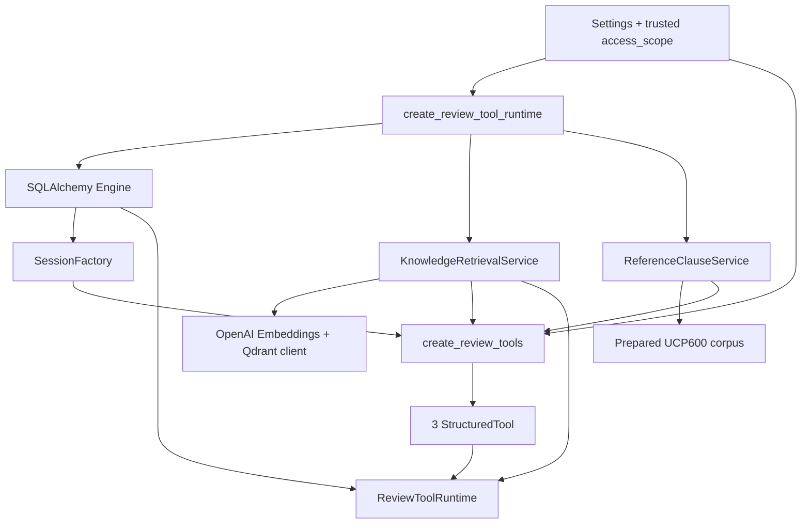
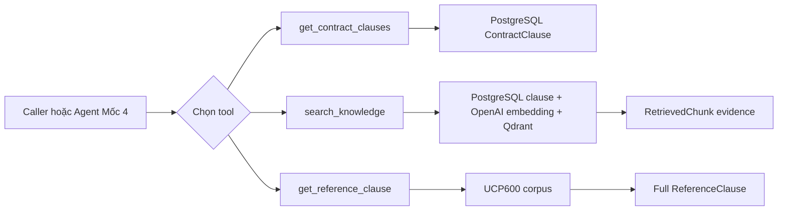
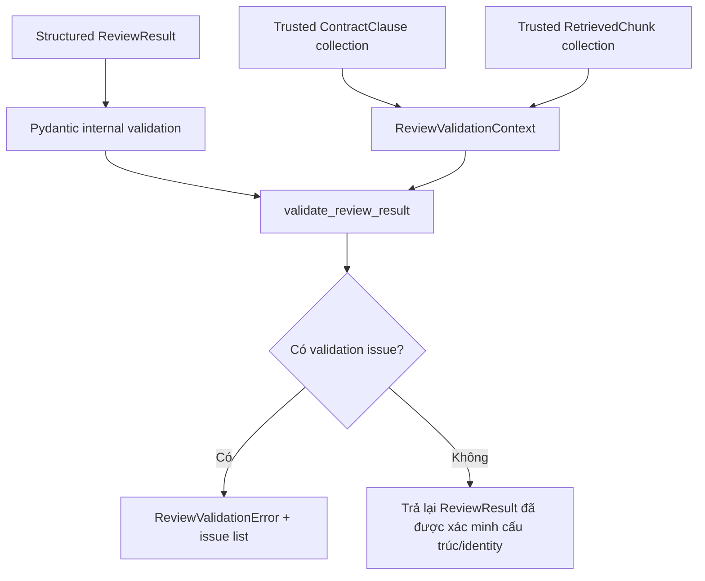

# Mốc 3 — Schema review, validator và ba LangChain tool

## 1. Mục đích của tài liệu

Tài liệu này trình bày lại toàn bộ Mốc 3 của Contract Review Agent dựa trên code hiện có trong repository.

Theo `docs/contract-agent-implementation-checklist.md`, Mốc 3 tương ứng với Bước 6–8:

1. Định nghĩa schema kết quả review.
2. Kiểm tra kết quả review dựa trên dữ liệu nguồn đáng tin cậy.
3. Bọc logic Mốc 1 và Mốc 2 thành ba LangChain tool có schema.

Mục tiêu của Mốc 3 là tạo một lớp biên an toàn giữa logic dữ liệu đã hoàn thành và agent sẽ được xây ở Mốc 4.

Luồng ngắn gọn:

```text
Mốc 1 cung cấp ContractClause
Mốc 2 cung cấp RetrievedChunk và ReferenceClause
        |
        v
Mốc 3 định nghĩa ReviewResult + validator + tools
        |
        v
Mốc 4 mới kết nối LLM/agent và tự điều phối tools
```

Mốc 3 chưa thực hiện các việc sau:

- chưa tạo LangChain agent;
- chưa kết nối ChatOpenAI để review;
- chưa có system prompt;
- chưa tự chọn tool theo câu hỏi;
- chưa sinh kết luận compliance thật;
- chưa có validation repair loop;
- chưa có API review;
- chưa ánh xạ kết quả cuối thành response highlight cho frontend.

---

## 2. Trạng thái triển khai hiện tại

### 2.1. Phần đã có code

Mốc 3 hiện có sáu file:

```text
backend/app/review/models.py
backend/app/review/validator.py
backend/app/review/tool_schemas.py
backend/app/review/tools.py
backend/app/review/runtime.py
backend/app/review/__init__.py
```

Các thành phần đã được định nghĩa:

- `ReviewFindingStatus` với ba trạng thái nghiệp vụ.
- `ReviewFinding` cho một nhận định trên một contract clause.
- `ReviewResult` cho toàn bộ kết quả review.
- `ReviewValidationContext` chứa clause và evidence đáng tin cậy.
- `ReviewValidationIssueCode`, `ReviewValidationIssue` và `ReviewValidationError`.
- Hàm deterministic `validate_review_result()`.
- Ba input schema và ba output schema cho tools.
- Factory `create_review_tools()`.
- Resource owner `ReviewToolRuntime`.
- Factory `create_review_tool_runtime()`.

### 2.2. Bằng chứng đã chạy

`py_compile` đã pass cho:

```text
app/review/runtime.py
app/review/__init__.py
```

Việc tạo ba tool đã pass và cho thấy đúng tên cùng input fields:

```text
Review tools creation passed
get_contract_clauses ['contract_id', 'labels']
search_knowledge ['clause_label', 'contract_id', 'question']
get_reference_clause ['article_number']
```

Kết quả này chứng minh:

- `StructuredTool` có thể được tạo;
- mỗi tool có tên đúng;
- LangChain nhìn thấy đúng argument schema;
- factory có thể nhận dependency đã cung cấp.

### 2.3. Phần chưa được nghiệm thu live

Theo quyết định hoãn test đến khi hoàn thành toàn hệ thống, hiện chưa có bằng chứng chạy cho các phần sau:

- chưa gọi thật `get_contract_clauses` qua `StructuredTool.invoke()`;
- chưa gọi thật `search_knowledge` qua tool;
- chưa gọi thật `get_reference_clause` qua tool;
- chưa chạy validator với một `ReviewResult` hợp lệ;
- chưa chạy từng mã lỗi của validator;
- chưa kiểm tra tool error propagation;
- chưa kiểm tra runtime đóng Qdrant/SQLAlchemy khi có exception;
- chưa kiểm tra concurrency khi nhiều review chạy cùng lúc;
- chưa kết nối output tool vào `ReviewValidationContext` tự động.

Vì vậy trạng thái chính xác là:

> **Mốc 3 đã hoàn thành phần implementation và tool construction, nhưng tiêu chí “ba tool chạy độc lập” cùng validator behavior được hoãn nghiệm thu đến giai đoạn test toàn hệ thống.**

### 2.4. Technical debt phát hiện khi review code

`backend/app/review/__init__.py` đang đưa các tên sau vào `__all__`:

```text
create_review_tools
ReviewToolRuntime
create_review_tool_runtime
```

nhưng file chưa import chúng từ `app.review.tools` và `app.review.runtime`.

`py_compile` không phát hiện lỗi này vì `__all__` chỉ là tuple chuỗi. Tuy nhiên public import như:

```python
from app.review import create_review_tools
```

sẽ chưa hoạt động đúng cho đến khi các symbol được import vào package namespace.

Đây là lỗi public export cần sửa trước khi Mốc 4 import runtime từ `app.review`.

---

## 3. Tại sao cần Mốc 3?

Nếu nối LLM trực tiếp với database và Qdrant, có bốn rủi ro lớn:

1. LLM có thể tự tạo clause ID không tồn tại.
2. LLM có thể trích một câu không có trong hợp đồng.
3. LLM có thể cite chunk chưa từng được retrieval trả về.
4. LLM có thể tự chọn `access_scope`, source hoặc version ngoài phạm vi được backend cho phép.

Mốc 3 tạo ba lớp bảo vệ:

```text
Tool input schema
  -> giới hạn loại và kích thước input

Trusted tool closures
  -> backend giữ scope/source/version

Review validator
  -> so output tương lai của agent với clause/evidence thật
```

Nói cách khác, Mốc 3 chưa tạo “bộ não” agent. Nó tạo hợp đồng dữ liệu và hàng rào để bộ não đó không được tự bịa identity hoặc nguồn.

---

## 4. Luồng hoạt động dữ liệu tổng thể

Mốc 3 có ba luồng: khởi tạo runtime, gọi tool, và validate kết quả review.

### 4.1. Luồng khởi tạo runtime



Input:

```text
Settings + access_scope do backend tin cậy cung cấp
```

Logic:

```text
tạo DB resources
  -> tạo knowledge services
  -> bind dependency và scope vào tool closures
  -> trả runtime sở hữu tools và resources
```

Output:

```text
ReviewToolRuntime
  .tools -> tuple[StructuredTool, ...]
  .close() -> đóng Qdrant và database engine
```

### 4.2. Luồng gọi ba tool



Ở Mốc 3 chưa có agent chọn tool. Việc chọn tool hiện do người viết smoke/import check hoặc caller thủ công quyết định.

### 4.3. Luồng validation kết quả review



Validator không gọi database hay Qdrant. Nó so kết quả với context đã được tool/backend lấy trước đó.

---

## 5. Ai quyết định bước tiếp theo?

| Điểm quyết định | Thành phần quyết định | Quy tắc | LLM có quyền không? |
|---|---|---|---|
| Runtime dùng database/Qdrant nào | `Settings` do backend nạp | URL/key không nhận từ tool input | Không |
| Access scope nào được dùng | Backend truyền vào `create_review_tool_runtime()` | Scope được bind trong closure | Không |
| Knowledge source/version nào được search | Constants `UCP600_SOURCE_ID` và `UCP600_SOURCE_VERSION` | Tool không expose hai giá trị này cho caller | Không |
| Tool nào được gọi ở Mốc 3 | Caller thủ công | Mốc 3 chưa có agent | Không có LLM |
| Tool nào sẽ được gọi ở Mốc 4 | Agent dưới system prompt và giới hạn | Chưa triển khai | Sau này có, nhưng input bị schema giới hạn |
| Tool input hợp lệ không | Pydantic args schema | UUID, length, Article 1–39, normalize labels | Không |
| Contract có tồn tại và READY không | `ContractClauseRetrievalService` | Quy tắc từ Mốc 1 | Không |
| Clause text nào được search | Backend load lại theo contract ID + label | Caller không được gửi raw clause giả | Không |
| Evidence nào được trả | `KnowledgeRetrievalService` + Qdrant | Filter scope/source/version và similarity ranking | Không phải answer LLM |
| Article nào được đọc | Caller gửi `article_number` | Input bị giới hạn 1–39 | Caller/agent chọn, service validate |
| Review status có hợp lệ về cấu trúc không | `ReviewFinding` | Kết luận dứt khoát phải có evidence ID | Không |
| Finding có thuộc contract/clause thật không | `validate_review_result()` | So với trusted context | Không |
| Quote có thật trong clause không | `validate_review_result()` | Whitespace-normalized substring | Không |
| Citation có từng được retrieval trả về không | `validate_review_result()` | Chunk ID phải có trong context | Không |
| Evidence có thực sự chứng minh kết luận không | Chưa có thành phần nào chứng minh đầy đủ | Cần eval/semantic review sau | Không được coi là đã giải quyết |
| Khi validation fail thì sửa hay trả lỗi | Mốc 4 `ReviewService` tương lai | Chưa triển khai repair policy | Chưa có |
| Khi chuyển sang Mốc 4 | Người review/operator | Chấp nhận code và các giới hạn còn lại | Không |

Điểm quan trọng: tool schema và validator quyết định tính hợp lệ kỹ thuật. Chúng không quyết định nhận định pháp lý đúng hay sai.

---

## 6. Thứ tự tạo file từ đầu đến cuối

Đây là thứ tự đã triển khai trong quá trình làm Mốc 3 và cũng là thứ tự dependency hợp lý:

| Thứ tự | File | Vấn đề được giải quyết | Phụ thuộc chính |
|---:|---|---|---|
| 1 | `backend/app/review/models.py` | Định nghĩa kết quả review và trusted validation context | Contract/RAG models từ Mốc 1–2 |
| 2 | `backend/app/review/validator.py` | Đối chiếu output review với clause/evidence thật | Review models |
| 3 | `backend/app/review/tool_schemas.py` | Định nghĩa input/output contract cho ba tool | ContractClause, RetrievedChunk, ReferenceClause |
| 4 | `backend/app/review/tools.py` | Bọc service Mốc 1–2 thành `StructuredTool` | Schemas + domain services |
| 5 | `backend/app/review/runtime.py` | Tạo/giữ/đóng resources dùng bởi tools | Tool factory + DB + knowledge factories |
| 6 | `backend/app/review/__init__.py` | Tạo public package API | Models, validator, tools và runtime |

Lý do phải theo thứ tự này:

- Validator cần biết `ReviewResult` và `ReviewValidationContext` trước.
- Tools cần input/output schema trước khi LangChain tạo tool definition.
- Runtime chỉ có thể tạo resources sau khi tool factory đã có.
- `__init__.py` nên là file cuối vì nó chỉ re-export API đã tồn tại.

Mốc 3 không thêm migration, table hoặc package mới. Nó tái sử dụng Pydantic, LangChain Core và SQLAlchemy đã có trong project.

---

## 7. Package và import được dùng để làm gì?

### 7.1. Package bên ngoài

| Package/import | File sử dụng | Tác dụng | Lý do chọn |
|---|---|---|---|
| `pydantic.BaseModel` | models, validator issues, tool schemas | Tạo schema có type và validation | Dùng chung data contract từ service đến agent/API. |
| `pydantic.Field` | models, validator, tool schemas | Giới hạn chuỗi, tuple, số và Article range | Reject input/output sai ngay tại boundary. |
| `pydantic.field_validator` | tool schemas | Normalize một field trước/sau parse | Phù hợp cho label/question riêng lẻ. |
| `pydantic.model_validator` | review models và tool outputs | Kiểm tra quan hệ giữa nhiều fields | Ví dụ finding phải thuộc checked clause. |
| `langchain_core.tools.StructuredTool` | tools và runtime | Biến Python function + Pydantic args thành tool cho LangChain | Agent Mốc 4 đọc được tên, description và JSON schema. |
| `sqlalchemy.Engine` | runtime | Type của database engine được runtime sở hữu | Runtime cần dispose connection pool đúng lúc. |

Không có import `ChatOpenAI` trong Mốc 3. Điều này xác nhận Mốc 3 chỉ tạo tools, chưa gọi model sinh câu trả lời.

### 7.2. Python standard library

| Import | Dùng ở đâu | Tác dụng |
|---|---|---|
| `enum.StrEnum` | models, validator | Enum có giá trị string dễ serialize sang JSON. |
| `uuid.UUID` | models, validator, schemas, tools | Identity contract/clause có type, không dùng string tùy ý. |
| `collections.abc.Callable` | tools | Type alias cho các function được chuyển thành tool. |
| `typing.Any` | tools | Kiểu value của JSON-like dictionary trả về LangChain. |
| `types.TracebackType` | runtime | Type đúng cho tham số traceback của context manager `__exit__`. |

### 7.3. Import nội bộ và ý nghĩa kiến trúc

| Import nội bộ | Vì sao cần |
|---|---|
| `ContractClause` | Schema review/context phải tham chiếu điều khoản thật từ Mốc 1. |
| `RetrievedChunk` | Finding citation phải đối chiếu với evidence thật từ Mốc 2. |
| `ReferenceClause` | Tool đọc Article phải trả loại dữ liệu khác search chunk. |
| `ContractClauseRetrievalService` | Tool không query ORM trực tiếp; tái sử dụng rule contract READY/scope. |
| `SessionFactory` | Mỗi tool call tạo session riêng rồi đóng ngay. |
| `KnowledgeRetrievalService` | Tool search dùng đúng query builder/filter Mốc 2. |
| `ReferenceClauseService` | Tool đọc toàn Article từ corpus gốc. |
| `UCP600_SOURCE_ID` | Khóa tool vào source `ucp600`. |
| `UCP600_SOURCE_VERSION` | Khóa tool vào version `1`. |
| `Settings` | Runtime tạo dependency bằng cấu hình backend. |
| `create_database_engine` | Tạo SQLAlchemy engine mà không lộ database URL. |
| `create_session_factory` | Tạo session ngắn hạn cho từng tool call. |
| `create_knowledge_retrieval_service` | Tạo embedding và Qdrant dependencies. |
| `create_ucp600_reference_service` | Chuẩn bị corpus và full Article lookup. |

---

## 8. Review từng file: Input → Logic → Output

## 8.1. `backend/app/review/models.py`

### Vấn đề file giải quyết

Trước Mốc 3, hệ thống có contract clauses và knowledge evidence nhưng chưa có kiểu dữ liệu thống nhất cho câu trả lời review.

Nếu chỉ trả một đoạn text tự do, backend không biết:

- finding nói về clause nào;
- status chính xác là gì;
- quote nào cần highlight;
- citation nào cần kiểm tra;
- những clause nào đã thực sự được review.

File này biến output review thành data contract có cấu trúc.

### 8.1.1. `ReviewFindingStatus`

Ba trạng thái:

```text
non_compliant
no_issue_found
insufficient_evidence
```

Ý nghĩa:

- `non_compliant`: có nhận định không phù hợp trong phạm vi đã kiểm tra.
- `no_issue_found`: chưa phát hiện vấn đề trong phạm vi đã kiểm tra; không đồng nghĩa bảo đảm toàn bộ hợp đồng hoàn hảo.
- `insufficient_evidence`: chưa đủ căn cứ để kết luận.

Lý do dùng `StrEnum`:

- Python code có enum type rõ ràng;
- JSON vẫn nhận chuỗi dễ đọc;
- tránh model tự tạo status tùy ý như `maybe_wrong`.

### 8.1.2. `ReviewFinding`

#### Input

```text
contract_id
clause_id
clause_label
contract_quote
status
reason
evidence_chunk_ids[]
```

#### Logic

`model_validator` kiểm tra:

1. Label, quote và reason không chỉ chứa whitespace.
2. Evidence chunk IDs không trùng.
3. Evidence chunk ID không rỗng.
4. Hai trạng thái kết luận `non_compliant` và `no_issue_found` bắt buộc có evidence.
5. `insufficient_evidence` được phép không có evidence.

#### Output

Một finding có cấu trúc, vẫn giữ `clause_id` và `contract_quote` để backend có thể tìm tọa độ nguồn.

#### Lý do lựa chọn

Evidence requirement được đặt ngay trong model để mọi nơi tạo `ReviewFinding` đều phải tuân thủ, không chỉ riêng validator.

### 8.1.3. `ReviewResult`

#### Input

```text
question
answer
contract_id
checked_clause_ids[]
knowledge_source_id
knowledge_source_version
findings[]
```

#### Logic

- Question và answer không được blank.
- Source ID/version không được blank.
- `checked_clause_ids` không được trùng.
- Mọi finding phải thuộc cùng `contract_id`.
- Mọi finding clause ID phải nằm trong `checked_clause_ids`.
- Phải có ít nhất một checked clause và một finding.

#### Output

Một review response có thể serialize sang JSON và tiếp tục được deterministic validator kiểm tra.

#### File này chưa kiểm tra gì?

`ReviewResult` chỉ kiểm tra quan hệ nội bộ của chính output. Nó chưa biết clause/evidence có thật trong database hay Qdrant. Việc đó thuộc `validator.py`.

### 8.1.4. `ReviewValidationContext`

#### Input

```text
trusted contract_id
trusted ContractClause[]
trusted RetrievedChunk[]
```

#### Logic

- Clause IDs trong context không được trùng.
- Tất cả clause phải thuộc đúng contract.
- Evidence chunk IDs không được trùng.

#### Output

Một tập nguồn đáng tin cậy để validator so sánh với output agent.

#### Vì sao context tách khỏi `ReviewResult`?

`ReviewResult` là dữ liệu do model tương lai sinh ra nên không được tự xem là đáng tin. Context đến từ backend/tools, vì vậy phải là object riêng để giữ ranh giới trust.

---

## 8.2. `backend/app/review/validator.py`

### Vấn đề file giải quyết

Pydantic có thể xác nhận UUID đúng format nhưng không biết UUID đó có thật. File này kiểm tra identity và quote dựa trên dữ liệu đã được backend lấy từ nguồn đáng tin.

### 8.2.1. `ReviewValidationIssueCode`

Các mã lỗi hiện có:

```text
contract_mismatch
checked_clause_not_found
finding_clause_not_found
clause_label_mismatch
contract_quote_mismatch
evidence_not_found
evidence_source_mismatch
evidence_version_mismatch
```

Lý do dùng mã lỗi thay vì chỉ có message:

- service/API có thể xử lý theo loại lỗi;
- repair prompt Mốc 4 có thể nói rõ model cần sửa phần nào;
- test không phụ thuộc nguyên văn tiếng Anh của message.

### 8.2.2. `ReviewValidationIssue`

#### Input

- issue code;
- message;
- optional finding index;
- optional clause ID;
- optional evidence chunk ID.

#### Output

Một lỗi có vị trí cụ thể, ví dụ lỗi nằm ở finding thứ 2 và chunk ID nào.

### 8.2.3. `ReviewValidationError`

#### Logic

- Giữ nguyên tuple `issues` để code phía trên xử lý có cấu trúc.
- Đồng thời ghép summary vào exception message để log/debug dễ đọc.

#### Output

Một `ValueError` chuyên biệt thay vì trả `False`, vì result sai không được tiếp tục đi vào API như kết quả hợp lệ.

### 8.2.4. `_normalize_source_text()`

#### Input

Một đoạn text có thể khác line break hoặc khoảng trắng.

#### Logic

```python
" ".join(value.split())
```

#### Output

Whitespace được gom thành một dấu cách nhưng từ ngữ không bị thay đổi.

Lý do: PDF raw text thường xuống dòng giữa câu. Nếu so string tuyệt đối, quote đúng vẫn có thể fail chỉ vì line break.

### 8.2.5. `validate_review_result()`

#### Input

```python
result: ReviewResult
context: ReviewValidationContext
```

#### Logic theo thứ tự

1. So `result.contract_id` với trusted `context.contract_id`.
2. Tạo dictionary `clause_id -> ContractClause`.
3. Kiểm tra mọi checked clause có trong context.
4. Tạo dictionary `chunk_id -> RetrievedChunk`.
5. Với từng finding:
   - tìm clause thật;
   - so label không phân biệt hoa/thường và surrounding whitespace;
   - normalize quote và raw clause text;
   - yêu cầu quote là substring của source text;
   - kiểm tra từng evidence chunk ID có trong context;
   - so evidence source ID;
   - so evidence source version.
6. Thu thập toàn bộ lỗi thay vì dừng ở lỗi đầu tiên.
7. Nếu có lỗi, raise một `ReviewValidationError` chứa tất cả issues.
8. Nếu không có lỗi, trả lại chính `ReviewResult`.

#### Output

```text
Valid -> ReviewResult
Invalid -> ReviewValidationError(issues=...)
```

#### Vì sao thu thập tất cả issues?

Nếu Mốc 4 có một validation repair attempt, gửi toàn bộ lỗi một lần sẽ tiết kiệm model call hơn sửa từng lỗi riêng.

#### Giới hạn quan trọng

Validator chứng minh:

- clause tồn tại;
- quote có trong clause;
- evidence từng được retrieval trả về;
- source và version khớp.

Validator chưa chứng minh:

- evidence thật sự hỗ trợ reason;
- Article được áp dụng đúng cho tình huống;
- kết luận compliance đúng về pháp lý;
- answer không chứa thêm nhận định thiếu căn cứ;
- question trong output đúng với question request ban đầu.

Do đó “citation tồn tại” không đồng nghĩa “citation entailment đúng”.

---

## 8.3. `backend/app/review/tool_schemas.py`

### Vấn đề file giải quyết

LangChain tool cần JSON schema rõ ràng. Không nên để agent gọi Python function với dictionary tự do.

File này chia schema thành input và output để:

- validate trước khi service chạy;
- mô tả argument cho agent;
- giữ output tool nhất quán;
- tránh agent gửi raw object hoặc field không kiểm soát.

### 8.3.1. `GetContractClausesInput`

#### Input

```text
contract_id: UUID
labels: array[string], từ 1 đến 20 label
```

#### Logic

`normalize_labels()` chạy ở `mode="before"`:

1. Chỉ chấp nhận list hoặc tuple.
2. Mọi phần tử phải là string.
3. Trim whitespace.
4. Chuyển uppercase.
5. Reject label blank.
6. Bỏ label trùng nhưng giữ thứ tự đầu tiên.
7. Pydantic tiếp tục áp min/max length.

#### Output

```text
contract_id typed UUID
labels normalized tuple[str, ...]
```

#### Vì sao giới hạn tối đa 20?

Ngăn một tool call yêu cầu quá nhiều clause, làm output/context phình quá lớn. Đây là guardrail ban đầu, chưa phải giới hạn hiệu năng đã benchmark.

### 8.3.2. `SearchKnowledgeInput`

#### Input

```text
contract_id
clause_label, tối đa 64 ký tự
question, tối đa 2000 ký tự
```

#### Logic

- Normalize clause label thành uppercase.
- Trim question.
- Reject blank.

#### Output

Input đã sạch để tool load lại clause thật và search.

#### Vì sao không nhận `raw_text`, `access_scope`, `source_id`, `source_version`?

- `raw_text` phải được load từ PostgreSQL, không tin nội dung agent gửi.
- `access_scope` phải do backend bind.
- source/version phải do backend khóa cho Mốc 2 UCP600.

Đây là một quyết định bảo mật quan trọng.

### 8.3.3. `GetReferenceClauseInput`

#### Input

```text
article_number: int từ 1 đến 39
```

#### Logic

Pydantic reject số ngoài phạm vi UCP600.

#### Output

Article number hợp lệ về mặt hình thức. Service vẫn phải kiểm tra Article thật sự tồn tại.

### 8.3.4. Ba output schemas

#### `GetContractClausesOutput`

- Input: requested contract ID + clauses từ service.
- Logic: mọi clause phải thuộc đúng contract ID.
- Output: contract ID và tuple clause có nguồn.

#### `SearchKnowledgeOutput`

- Input: contract ID, clause ID/label thật, retrieved evidence.
- Logic: Pydantic validate từng nested `RetrievedChunk`.
- Output: search result gắn với clause đã search.
- Evidence được phép là tuple rỗng vì “không tìm thấy” là một trạng thái retrieval hợp lệ.

#### `GetReferenceClauseOutput`

- Input: một `ReferenceClause` từ Mốc 2.
- Output: wrapper có tên field rõ cho tool consumer.

---

## 8.4. `backend/app/review/tools.py`

### Vấn đề file giải quyết

Service Mốc 1–2 là Python API. LangChain agent cần tool objects có:

- name;
- description;
- Pydantic argument schema;
- callable function;
- JSON-compatible output.

File này làm adapter, không viết lại logic contract hoặc retrieval.

### 8.4.1. Input của tool factory

```python
create_review_tools(
    session_factory: SessionFactory,
    knowledge_service: KnowledgeRetrievalService,
    reference_service: ReferenceClauseService,
    access_scope: str,
) -> tuple[StructuredTool, ...]
```

Các dependency đều do backend cung cấp. Agent không được tạo client hay chọn scope.

### 8.4.2. Closure và trusted access scope

Factory trim `access_scope` một lần rồi ba inner functions cùng đóng trên `normalized_scope`.

Ví dụ, schema của `search_knowledge` chỉ có:

```text
contract_id
clause_label
question
```

nhưng function vẫn gọi service với:

```text
access_scope=normalized_scope
source_id=ucp600
source_version=1
```

Lý do dùng closure:

- không expose security context cho model;
- không cần global variable;
- mỗi runtime có thể được tạo cho một trusted scope;
- function signature vẫn nhỏ và dễ mô tả cho LLM.

### 8.4.3. Tool `get_contract_clauses`

#### Input

```text
contract_id + normalized labels[]
```

#### Logic

1. Mở một SQLAlchemy session từ factory.
2. Tạo `ContractClauseRetrievalService` cho session đó.
3. Với từng label, gọi `get_by_label()`.
4. Service kiểm tra contract trong scope và trạng thái READY.
5. Thoát context để đóng session.
6. Bọc clauses trong `GetContractClausesOutput`.
7. Gọi `model_dump(mode="json")`.

#### Output

JSON-compatible dictionary chứa contract ID và đầy đủ clauses/source spans.

#### Vấn đề được giải quyết

Agent không được tự tạo hoặc tự quote contract text. Nó phải lấy nguyên văn từ trusted database.

#### Ghi chú hiệu năng

Mỗi label hiện gọi `get_by_label()` riêng; service cũng kiểm tra contract READY mỗi lần. Với tối đa 20 label, cách này đúng nhưng có thể tạo query lặp. Có thể tối ưu batch retrieval sau khi có benchmark.

### 8.4.4. Tool `search_knowledge`

#### Input

```text
contract_id + clause_label + question
```

#### Logic

1. Mở DB session.
2. Load lại clause thật từ PostgreSQL theo trusted scope.
3. Đóng DB session.
4. Gửi question + domain clause thật vào `KnowledgeRetrievalService`.
5. Khóa source/version bằng constants UCP600.
6. Nhận tuple `RetrievedChunk`.
7. Bọc kết quả bằng `SearchKnowledgeOutput`.
8. Serialize thành JSON-compatible dictionary.

#### Output

```text
contract_id
clause_id
clause_label
evidence[]
```

#### Vấn đề được giải quyết

Agent chỉ được chọn contract, label và câu hỏi. Agent không thể gửi một raw clause đã sửa để điều khiển retrieval.

### 8.4.5. Tool `get_reference_clause`

#### Input

```text
article_number
```

#### Logic

1. Gọi `ReferenceClauseService.get_article()`.
2. Dùng constants source/version và trusted scope.
3. Bọc kết quả trong `GetReferenceClauseOutput`.
4. Serialize thành dictionary.

#### Output

Một full `ReferenceClause` gồm title, raw text, checksum, page range và source spans.

#### Vấn đề được giải quyết

Search evidence có thể chỉ là một đoạn nhỏ. Tool này cho agent đọc đủ Article trước khi reason.

### 8.4.6. Tool descriptions

Description được viết để hướng agent:

- `get_contract_clauses`: dùng trước khi review hoặc quote; không tự đánh giá compliance.
- `search_knowledge`: trả candidate evidence; không có kết quả không chứng minh không có rule.
- `get_reference_clause`: chỉ dùng sau khi search cho thấy Article liên quan; số Article là của UCP600, không phải contract clause.

Description là hướng dẫn cho model, không phải security boundary. Security boundary thật nằm ở schema, closures và domain services.

### 8.4.7. `StructuredTool.from_function()`

Với từng tuple `(function, name, description, args_schema)`, LangChain tạo một `StructuredTool`.

Output cuối của factory:

```python
(
    get_contract_clauses_tool,
    search_knowledge_tool,
    get_reference_clause_tool,
)
```

### 8.4.8. Giới hạn hiện tại liên quan Mốc 4

Tools đang trả plain dictionary. Agent có thể nhìn nội dung đó, nhưng `ReviewService` tương lai vẫn cần xây `ReviewValidationContext` từ chính các tool results đáng tin cậy.

Một phương án ở Mốc 4 là dùng `content_and_artifact` để:

- gửi JSON content cho model;
- giữ domain artifact cho backend validator;
- không phải tin dữ liệu được model lặp lại.

Đây chưa phải code Mốc 3 hiện tại và phải được thiết kế rõ trước khi sửa tools.

---

## 8.5. `backend/app/review/runtime.py`

### Vấn đề file giải quyết

Ba tools dùng resources có lifecycle khác nhau:

- SQLAlchemy engine/connection pool;
- Qdrant client bên trong knowledge service;
- embedding client;
- prepared UCP600 corpus/reference service.

Nếu caller chỉ nhận tuple tools mà không biết ai sở hữu resources, client có thể bị quên đóng hoặc bị đóng quá sớm.

### 8.5.1. `ReviewToolRuntime`

#### Input constructor

```text
tools
SQLAlchemy engine
KnowledgeRetrievalService
```

Reference service không cần `close()` vì hiện chỉ giữ corpus trong memory, không giữ network client.

#### Logic

- `.tools` chỉ trả tools khi runtime còn mở.
- `.close()` là idempotent: gọi lần hai không làm gì.
- Đóng knowledge/Qdrant trước.
- Dùng `finally` để luôn dispose database engine, kể cả khi đóng knowledge service lỗi.
- Hỗ trợ `with ReviewToolRuntime(...) as runtime:`.
- `__exit__()` luôn gọi `close()`.

#### Output

Một object vừa cung cấp tools vừa làm resource owner rõ ràng.

#### Vì sao `_closed` cần thiết?

- tránh dùng tools sau khi client đã đóng;
- tránh dispose cùng resource nhiều lần;
- làm lifecycle error xuất hiện sớm và rõ.

### 8.5.2. `create_review_tool_runtime()`

#### Input

```text
Settings
trusted access_scope
```

#### Logic theo thứ tự

1. Tạo database engine.
2. Tạo session factory.
3. Tạo knowledge retrieval service.
4. Tạo UCP600 reference service và chuẩn bị corpus.
5. Tạo ba review tools với trusted scope.
6. Tạo `ReviewToolRuntime` sở hữu engine và knowledge service.
7. Nếu bất kỳ bước nào lỗi:
   - đóng knowledge service nếu đã tạo;
   - dispose engine;
   - re-raise lỗi gốc.

#### Output

```python
ReviewToolRuntime
```

#### Vì sao có cleanup trong `except`?

Nếu Qdrant client đã mở nhưng parser corpus lỗi, function không trả runtime nên caller không có object để gọi `.close()`. Factory phải tự bù cleanup cho phần resource đã tạo.

#### Ai quyết định bước tiếp?

- Nếu toàn bộ dependency tạo thành công, factory trả runtime.
- Nếu một dependency lỗi, exception dừng quá trình; tools không được đưa cho agent trong trạng thái nửa khởi tạo.

---

## 8.6. `backend/app/review/__init__.py`

### Vấn đề file giải quyết

Package cần public import path ổn định để Mốc 4 không phụ thuộc vào từng file nội bộ.

Mục tiêu dự kiến:

```python
from app.review import (
    ReviewResult,
    validate_review_result,
    create_review_tool_runtime,
)
```

### Input

Các public symbols từ models, validator, tools và runtime.

### Logic

- Import public types/functions vào package namespace.
- Khai báo `__all__` để document public API và hỗ trợ star import.

### Output

Một package facade `app.review`.

### Trạng thái hiện tại

File đã import đầy đủ models và validator, nhưng chưa có:

```python
from app.review.tools import create_review_tools
from app.review.runtime import (
    ReviewToolRuntime,
    create_review_tool_runtime,
)
```

trong khi ba tên vẫn nằm trong `__all__`.

Do đó:

- `py_compile` pass;
- import models/validator từ `app.review` hoạt động;
- public import tools/runtime từ `app.review` chưa hoàn chỉnh.

Đây là mục cần sửa trước Mốc 4.

---

## 9. Input và output của ba tool cạnh nhau

| Tool | Input do caller/agent cung cấp | Dữ liệu backend tự bind | Logic chính | Output |
|---|---|---|---|---|
| `get_contract_clauses` | `contract_id`, `labels[]` | `access_scope`, DB session factory | Load contract READY và exact clauses | Contract ID + `ContractClause[]` |
| `search_knowledge` | `contract_id`, `clause_label`, `question` | scope, `ucp600`, version `1`, DB/Qdrant/embedding clients | Load clause thật rồi dense search | Clause identity + `RetrievedChunk[]` |
| `get_reference_clause` | `article_number` | scope, `ucp600`, version `1`, prepared corpus | Lookup full Article | `ReferenceClause` |

Điểm phân biệt:

```text
47A.2 = label của contract clause
16    = Article number của UCP600
```

Tool descriptions cố ý nhắc điều này để giảm nhầm lẫn.

---

## 10. Dữ liệu thay đổi hình dạng như thế nào?

### 10.1. Tool lấy contract clause

```text
JSON tool arguments
  contract_id string + labels array
        |
        v
GetContractClausesInput
  UUID + normalized tuple
        |
        v
ContractClauseRetrievalService
        |
        v
ContractClause domain models
        |
        v
GetContractClausesOutput
        |
        v
JSON-compatible dict
```

### 10.2. Tool search knowledge

```text
JSON tool arguments
        |
        v
SearchKnowledgeInput
        |
        v
load trusted ContractClause from PostgreSQL
        |
        v
question + clause -> embedding -> Qdrant
        |
        v
RetrievedChunk[]
        |
        v
SearchKnowledgeOutput -> JSON dict
```

### 10.3. Tool đọc full Article

```text
article_number
        |
        v
GetReferenceClauseInput
        |
        v
ReferenceClauseService
        |
        v
ReferenceClause
        |
        v
GetReferenceClauseOutput -> JSON dict
```

### 10.4. Validation data

```text
Agent-generated JSON
        |
        v
ReviewResult

Trusted tool/domain objects
        |
        v
ReviewValidationContext

ReviewResult + ReviewValidationContext
        |
        v
validate_review_result
        |
        +--> valid ReviewResult
        |
        +--> ReviewValidationError with issues
```

---

## 11. Trust boundary và bảo mật

### 11.1. Dữ liệu không được tin trực tiếp

- Contract ID/label do agent gửi chỉ là yêu cầu lookup.
- Question có thể chứa nội dung người dùng hoặc prompt injection.
- ReviewResult tương lai do LLM tạo không được coi là đúng.
- Evidence IDs do LLM lặp lại phải được validator kiểm tra.

### 11.2. Dữ liệu được xem là trusted sau boundary

- `ContractClause` do repository/service lấy trong đúng scope.
- `RetrievedChunk` do filtered retrieval trả về và Pydantic validate.
- `ReferenceClause` do corpus service tạo từ PDF UCP600.
- `access_scope`, source ID và version do backend bind.

### 11.3. Tool description không phải bảo mật

Model có thể không tuân thủ description. Vì vậy code vẫn:

- không expose `access_scope`;
- không expose source/version;
- load raw clause từ DB;
- giới hạn Article number;
- validate output sau agent.

### 11.4. Prompt injection chưa được giải quyết hoàn toàn ở Mốc 3

Tool trả raw contract/knowledge text. Nội dung tài liệu có thể chứa câu giống chỉ dẫn cho agent. Mốc 4 phải có system prompt yêu cầu coi tool content là dữ liệu, không phải instruction.

Mốc 3 chỉ chuẩn bị data boundary; nó chưa có system prompt để thực thi quy tắc này.

---

## 12. Các lỗi có thể phát sinh và lớp chịu trách nhiệm

| Lỗi | Lớp phát hiện | Kết quả |
|---|---|---|
| Scope rỗng | `create_review_tools()` | `ValueError` |
| Contract ID sai format | Pydantic tool input | Validation error trước tool function |
| Labels không phải array | `GetContractClausesInput` | Validation error |
| Quá 20 labels | Pydantic `Field(max_length=20)` | Validation error |
| Contract không tồn tại trong scope | Contract retrieval service | `ContractNotFoundError` |
| Contract chưa READY | Contract retrieval service | `ContractNotReadyError` |
| Clause không tồn tại | Contract retrieval service | `ContractClauseNotFoundError` |
| Question blank/quá dài | `SearchKnowledgeInput` | Validation error |
| Không có evidence | Knowledge service | Tool trả `evidence=()`; không tự kết luận |
| Article ngoài 1–39 | `GetReferenceClauseInput` | Validation error |
| Article/source không tồn tại | Reference service | Domain lookup error |
| Finding dứt khoát không có evidence | `ReviewFinding` | Pydantic validation error |
| Finding dùng contract khác | `ReviewResult` hoặc validator | Validation error/issue |
| Quote không có trong clause | Review validator | `contract_quote_mismatch` |
| Chunk ID chưa từng được retrieval trả | Review validator | `evidence_not_found` |
| Qdrant close lỗi | Runtime close | Engine vẫn dispose trong `finally` |
| Runtime bị dùng sau close | `.tools` property | `RuntimeError` |

Mốc 4 phải quyết định lỗi nào có thể repair một lần và lỗi nào phải trả ngay cho caller.

---

## 13. Tại sao các lựa chọn thiết kế này được đưa ra?

### 13.1. Structured output thay vì text tự do

Frontend và validator cần ID, status, quote và evidence IDs. Một đoạn văn tự do không đủ ổn định để highlight hoặc audit.

### 13.2. Ba trạng thái thay vì chỉ compliant/non-compliant

Thiếu evidence không được tự biến thành compliant. `insufficient_evidence` giữ sự khác biệt giữa “không thấy lỗi” và “không đủ căn cứ để biết”.

### 13.3. Conclusive finding bắt buộc có evidence

Cả `non_compliant` và `no_issue_found` đều là kết luận. Hai loại này cần evidence; chỉ `insufficient_evidence` có thể không có.

### 13.4. Validator deterministic

Identity, exact quote và citation membership là việc code có thể kiểm tra chắc chắn. Không nên gọi thêm LLM cho những kiểm tra này.

### 13.5. Aggregate issues

Thu thập tất cả lỗi giúp debug và hỗ trợ một repair call có giới hạn ở Mốc 4.

### 13.6. Tool functions mỏng

Tools chỉ làm adapter. Business logic vẫn nằm trong contract/knowledge services nên CLI, API và agent dùng chung một implementation.

### 13.7. Scope được bind bằng closure

Agent không phải security principal. Scope phải đến từ authentication/backend context, không đến từ tool arguments do model sinh.

### 13.8. Source/version dùng constants

Mốc đầu chỉ hỗ trợ UCP600 version 1. Khóa source/version làm hành vi rõ ràng và ngăn model chuyển nguồn tùy ý. Interface service Mốc 2 vẫn có source/version để mở rộng về sau.

### 13.9. Mỗi DB tool call dùng session ngắn hạn

Session được mở trong `with` và đóng trước khi tool trả output. Điều này tránh giữ transaction/session suốt vòng đời agent.

### 13.10. Runtime sở hữu resources

Object nào tạo network/database resources phải có trách nhiệm đóng chúng. Caller chỉ cần quản lý một runtime thay vì nhớ đóng từng client.

### 13.11. Không tạo agent ở Mốc 3

Tách tools khỏi agent cho phép kiểm tra từng tool và validation contract trước. Nếu agent sai, có thể xác định lỗi ở orchestration thay vì không biết lỗi nằm trong tool hay model.

---

## 14. Những gì validator đảm bảo và không đảm bảo

| Câu hỏi | Mốc 3 validator trả lời được? |
|---|---|
| Contract ID có đúng context không? | Có |
| Clause ID có tồn tại trong tập đã load không? | Có |
| Label có khớp clause không? | Có |
| Quote có xuất hiện trong raw clause không? | Có, sau normalize whitespace |
| Evidence chunk có từng được retrieval trả không? | Có |
| Evidence source/version có khớp result không? | Có |
| Evidence có cùng access scope không? | Gián tiếp dựa vào trusted retrieval; chưa so trực tiếp trong validator |
| Checksum có đúng source được khai báo không? | Chưa so trực tiếp ở validator |
| Evidence có hỗ trợ reason không? | Không |
| Rule có áp dụng pháp lý đúng không? | Không |
| Answer có được grounded hoàn toàn không? | Không |
| Model có bỏ sót một issue không? | Không thể chứng minh chỉ bằng schema |

Vì vậy Mốc 4 và bộ acceptance cases cuối vẫn cần đánh giá chất lượng reasoning, không chỉ validation pass.

---

## 15. Ví dụ luồng dự kiến với LC01 / 47A.2

Mốc 3 chưa tự chạy luồng này bằng agent, nhưng các tool được thiết kế để Mốc 4 gọi theo thứ tự sau:

### Bước A — Lấy clause thật

```text
get_contract_clauses(
  contract_id=b2dbb53e-eea0-46c6-9fe5-2ed3d3578b62,
  labels=["47A.2"]
)
```

Output chứa:

```text
label=47A.2
raw_text=2/ DISCREPANCY FEE OF USD77 ...
page=3
contract source spans
```

### Bước B — Tìm evidence

```text
search_knowledge(
  contract_id=...,
  clause_label="47A.2",
  question="What UCP 600 provision governs refusal due to discrepancies?"
)
```

Output chứa top-k `RetrievedChunk`, trong đó happy path Mốc 2 đã thấy Article 16.

### Bước C — Đọc toàn Article

```text
get_reference_clause(article_number=16)
```

Output chứa toàn văn Article 16, page 6 và 24 source spans.

### Bước D — Tạo review result

Mốc 4 mới yêu cầu model tạo:

```text
ReviewResult
  -> checked clause 47A.2
  -> one or more findings
  -> exact contract quote
  -> retrieved evidence chunk IDs
```

### Bước E — Validate

Backend tạo `ReviewValidationContext` từ clause/evidence thật rồi gọi:

```python
validate_review_result(
    result=result,
    context=context,
)
```

Mốc 3 đã có validator function nhưng chưa có service tự nối Bước D và E.

---

## 16. Checklist review Mốc 3

### 16.1. Review schema

- [x] Có `ReviewFindingStatus` với ba trạng thái.
- [x] Có `ReviewFinding` gắn contract/clause/quote/reason/evidence.
- [x] Kết luận dứt khoát bắt buộc có evidence ID.
- [x] Có `ReviewResult` chứa question, answer, scope đã kiểm tra và findings.
- [x] Finding phải thuộc contract và checked clause của result.
- [x] Có `ReviewValidationContext` tách khỏi untrusted output.

### 16.2. Validator

- [x] Kiểm tra contract mismatch.
- [x] Kiểm tra checked clause tồn tại.
- [x] Kiểm tra finding clause tồn tại.
- [x] Kiểm tra label khớp.
- [x] Kiểm tra quote là substring của raw clause sau normalize whitespace.
- [x] Kiểm tra evidence từng được retrieval trả.
- [x] Kiểm tra evidence source/version.
- [x] Trả issue có code và vị trí.
- [x] Thu thập nhiều lỗi trong một lần.
- [ ] Chưa có smoke/unit test đã chạy cho validator.
- [ ] Chưa kiểm tra semantic entailment.

### 16.3. Tool schemas

- [x] Input schemas có type và giới hạn.
- [x] Label được normalize.
- [x] Scope không expose cho agent.
- [x] Source/version không expose cho agent.
- [x] Outputs chứa domain data có nguồn.
- [x] Search output cho phép evidence rỗng.

### 16.4. Tool factory

- [x] Có `get_contract_clauses`.
- [x] Có `search_knowledge`.
- [x] Có `get_reference_clause`.
- [x] Tool descriptions nêu rõ mục đích và giới hạn.
- [x] Tool construction đã pass.
- [ ] Chưa có bằng chứng `StructuredTool.invoke()` cho từng tool.
- [ ] Chưa thu trusted tool artifacts tự động cho validator.

### 16.5. Runtime

- [x] Tạo engine/session factory.
- [x] Tạo knowledge/reference services.
- [x] Tạo tools với trusted scope.
- [x] Có context manager.
- [x] Close idempotent.
- [x] Factory failure có compensation cleanup.
- [ ] Chưa chạy lifecycle test.

### 16.6. Package API

- [x] Models và validator được import trong `app.review.__init__`.
- [ ] `create_review_tools` chưa được import vào package namespace.
- [ ] `ReviewToolRuntime` chưa được import vào package namespace.
- [ ] `create_review_tool_runtime` chưa được import vào package namespace.

---

## 17. Công việc nên hoàn tất trước hoặc trong Mốc 4

### Bắt buộc

1. Sửa public exports trong `app/review/__init__.py`.
2. Chọn cách giữ trusted outputs từ tool calls để tạo `ReviewValidationContext`.
3. Tạo agent với structured response `ReviewResult`.
4. Thêm system prompt coi document content là data, không phải instruction.
5. Thiết lập tool/model call limits.
6. Thiết lập timeout và error mapping.
7. Gọi deterministic validator trước khi trả result.
8. Quy định tối đa bao nhiêu lần repair khi validation fail.

### Có thể tối ưu sau happy path

- Batch query nhiều labels để giảm database round trips.
- So trực tiếp evidence access scope/checksum trong validator.
- Normalize/display PDF hyphenation mà không làm mất raw source.
- Thêm semantic entailment evaluation bằng golden cases.

---

## 18. Mốc 3 bàn giao gì cho Mốc 4?

Mốc 3 bàn giao bốn nhóm API:

```text
1. Structured result contracts
   ReviewFindingStatus
   ReviewFinding
   ReviewResult

2. Trusted validation contracts
   ReviewValidationContext
   ReviewValidationIssue
   ReviewValidationError
   validate_review_result

3. Tool contracts và implementations
   GetContractClausesInput/Output
   SearchKnowledgeInput/Output
   GetReferenceClauseInput/Output
   create_review_tools

4. Resource lifecycle
   ReviewToolRuntime
   create_review_tool_runtime
```

Mốc 4 sẽ chịu trách nhiệm:

```text
question + contract_id
  -> agent chọn/gọi tools
  -> structured ReviewResult
  -> trusted validation context
  -> deterministic validator
  -> pass hoặc repair/error có giới hạn
```

---

## 19. Kết luận review

Mốc 3 đã tạo đúng lớp trung gian giữa domain services và agent tương lai:

- output review có schema rõ;
- ba trạng thái compliance không đánh đồng thiếu căn cứ với phù hợp;
- citation và contract quote có deterministic validator;
- tools tái sử dụng logic Mốc 1–2 thay vì sao chép;
- scope, UCP source và version nằm dưới quyền backend;
- runtime làm rõ quyền sở hữu và cleanup resources;
- chưa gọi LLM nên chưa phát sinh chi phí generation ở Mốc 3.

Trạng thái chính xác:

> **Implementation của Mốc 3 đã có đủ models, validator, schemas, tools và runtime. Tool construction đã pass; tool invocation, validator behavior, lifecycle và public package export vẫn cần hoàn tất hoặc nghiệm thu trước khi coi Mốc 3 đóng kín theo checklist.**
