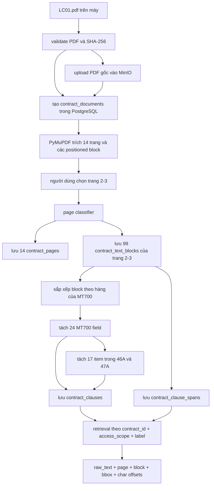

# System Phase — Mốc 1: đọc, lưu và truy xuất điều khoản LC01

## 1. Mục đích của tài liệu

Tài liệu này trình bày lại toàn bộ **Mốc 1, tương ứng Bước 1–3** trong `docs/contract-agent-implementation-checklist.md`:

1. Định nghĩa dữ liệu hợp đồng.
2. Đọc và lưu hợp đồng.
3. Truy xuất một điều khoản theo `contract_id` và `label` hoặc `clause_id`.

Mục tiêu cuối của Mốc 1 là:

> Từ file gốc `LC01.pdf`, hệ thống lưu được file và dữ liệu có cấu trúc, sau đó lấy lại đúng nguyên văn điều khoản cùng trang, block và tọa độ nguồn.

Mốc 1 **chưa dùng LLM, LangChain, OpenAI, Qdrant hoặc agent**. Các quyết định trong mốc này là deterministic: cùng một PDF và cùng cấu hình trang thì phải cho cùng cấu trúc field/item.

## 2. Trạng thái nghiệm thu hiện tại

### 2.1. Phần đã chạy thành công với LC01

- MinIO nhận PDF, kiểm tra checksum và xóa object thử nghiệm thành công.
- PostgreSQL có đủ 5 bảng của contract pipeline.
- Alembic đã chạy hai migration theo đúng thứ tự.
- LC01 được ingest với `page_count=14` và trạng thái ban đầu `uploaded`.
- Chỉ trang 2–3 được chọn để đọc nội dung.
- Trang 1 là cover; trang 4–14 bị đánh dấu ngoài phạm vi.
- Đã lưu metadata của 14 trang và 99 text block của trang 2–3.
- Trạng thái tài liệu sau xử lý là `ready`; không có trang cần OCR trong phạm vi đã chọn.
- Parser tìm được 24 MT700 field.
- Parser tìm được 17 numbered item: `46A.1`–`46A.6` và `47A.1`–`47A.11`.
- Tổng cộng lưu được 41 clause.
- Đã truy xuất đúng `47A.2`, gồm nguyên văn, trang 3 và hai source span.

Kết quả đã quan sát:

```text
label=47A.2
title=Additional Conditions item 2
kind=swift_item
page_range=3-3
source_span_count=2
raw_text:
2/ DISCREPANCY FEE OF USD77 OR EQUIVALENT WILL BE DEDUCT FROM
THE PROCEEDS FOR EACH PRESENTATION OF DISCREPANT DOCUMENT.
```

### 2.2. Phần đã có code nhưng cần test thêm để nghiệm thu kín Mốc 1

- Script hiện đã in `bbox`, `block_index` và `char_start:char_end`, nhưng cần chạy lại lệnh retrieval để lưu bằng chứng đầu ra cuối cùng.
- Code đã phân biệt:
  - không tìm thấy contract;
  - contract chưa `ready`;
  - không tìm thấy clause.
  Tuy nhiên chưa có bằng chứng chạy thực tế cho cả ba nhánh lỗi.
- Chưa có bộ `pytest` tự động cho contract pipeline; các kiểm tra hiện tại chủ yếu là import check và smoke test chạy thật.
- `access_scope="public"` đang được hard-code trong các script thử nghiệm. Khi làm API, scope phải đến từ lớp xác thực tin cậy, không nhận tùy ý từ người dùng.
- Pipeline xử lý lại file local để lấy text. PDF gốc đã được lưu trên MinIO, nhưng chưa có bước tải file từ MinIO về khi chỉ có `contract_id`.

Vì vậy, **happy path của Mốc 1 đã chạy thành công**, nhưng nên hoàn thành các test âm và test tự động trước khi gọi Mốc 1 là production-ready.

## 3. Luồng dữ liệu từ đầu đến cuối



Luồng ngắn gọn:

```text
PDF gốc
  -> checksum + MinIO
  -> contract metadata
  -> page và positioned block
  -> field MT700
  -> numbered item
  -> clause + source span
  -> truy xuất lại đúng nguyên văn và vị trí
```

## 4. Ai quyết định bước tiếp theo?

| Quyết định | Thành phần quyết định | Lý do |
|---|---|---|
| File nào được xử lý | Operator/script `ingest_lc01.py` | Mốc 1 đang thử nghiệm có kiểm soát với LC01, chưa có API upload. |
| Dùng database và MinIO nào | `Settings` đọc environment | Tách cấu hình khỏi code và không ghi secret vào source. |
| Upload mới hay trả bản đã có | `ContractIngestionService` + `ContractDocumentRepository` | So checksum trong cùng `access_scope` để tránh ingest trùng. |
| Chỉ xử lý trang nào | Người dùng/nghiệp vụ truyền `{2, 3}` | Đây là phạm vi review, code không được tự đoán thay người dùng. |
| Trang là text, cover, ngoài phạm vi hay cần OCR | `page_classifier.py` | Biến quyết định phạm vi thành trạng thái rõ ràng cho từng trang. |
| Block nào đứng trước | `reading_order.py` | Dựa vào tọa độ `y` rồi `x` theo bố cục hàng của MT700. |
| Khi nào bắt đầu field mới | `mt700_parser.py` | Một heading hợp lệ bắt đầu bằng hai chữ số, có thể kèm option A–Z. |
| Field nào được tách item con | Script/service truyền `{"46A", "47A"}` | Chỉ hai field này có danh sách `N/` trong mẫu LC01 đã kiểm tra. |
| Khi nào bắt đầu item mới | `mt700_item_parser.py` | Regex nhận marker đầu dòng như `1/`, `2/`, ... và yêu cầu số tăng dần. |
| Dữ liệu có được commit không | Processing service + SQLAlchemy transaction | Chỉ commit khi toàn bước thành công; lỗi thì rollback và ghi trạng thái `failed`. |
| Người gọi có được thấy contract không | Repository lọc `access_scope` | Không cho truy vấn vượt phạm vi dữ liệu. |
| Có được trả clause không | `ContractClauseRetrievalService` | Contract phải tồn tại trong scope và có trạng thái `ready`. |
| Có chuyển sang Mốc 2 không | Người review/operator | Chỉ chuyển khi tiêu chí Mốc 1 và các kiểm tra còn thiếu được chấp nhận. |

Không có LLM nào quyết định các bước trên trong Mốc 1.

## 5. Thứ tự tạo và phụ thuộc giữa các file

Đây là thứ tự triển khai/phụ thuộc nên dùng để review. Một số file dùng chung đã tồn tại trước contract pipeline; chúng được ghi là “tái sử dụng”.

| Thứ tự | File | Vai trò |
|---:|---|---|
| 0 | `backend/app/rag/models.py` | Tái sử dụng model `ExtractedPage` và `PageTextBlock`. |
| 0 | `backend/app/rag/ingestion/source_loader.py` | Tái sử dụng kiểm tra file PDF. |
| 0 | `backend/app/rag/ingestion/pdf_extractor.py` | Tái sử dụng PyMuPDF để lấy text block và bbox. |
| 1 | `backend/requirements.txt` | Thêm package PostgreSQL, Alembic và MinIO. |
| 2 | `.env.example` và `backend/app/core/config.py` | Khai báo tên biến cấu hình, đọc secret an toàn. |
| 3 | `compose.yaml` và `backend/Dockerfile` | Chạy PostgreSQL/backend trong container. |
| 4 | `backend/app/db/base.py` | Tạo ORM base và quy tắc tên constraint. |
| 5 | `backend/app/db/session.py` | Tạo engine, session và transaction boundary. |
| 5a | `backend/app/db/__init__.py` | Re-export API database dùng chung. |
| 5b | `backend/app/contracts/__init__.py` | Đánh dấu namespace của contract domain. |
| 6 | `backend/app/contracts/models.py` | Định nghĩa domain model và invariant. |
| 7 | `backend/app/contracts/db_models.py` | Ánh xạ domain data thành 5 bảng PostgreSQL. |
| 8 | `backend/alembic.ini` và `backend/migrations/env.py` | Kết nối Alembic với metadata và database URL. |
| 9 | `02b65599686f_create_contract_tables.py` | Tạo schema contract đầu tiên. |
| 10 | `backend/app/contracts/storage.py` | Checksum, upload, kiểm tra và xóa PDF trên MinIO. |
| 11 | `backend/scripts/contracts/smoke_storage.py` | Kiểm tra MinIO thật bằng LC01 rồi dọn object thử. |
| 12 | `backend/app/contracts/repository.py` | Đọc/ghi document record theo ID, checksum và scope. |
| 13 | `backend/app/contracts/ingestion_service.py` | Điều phối checksum → MinIO → document record. |
| 14 | `backend/scripts/contracts/ingest_lc01.py` | Entry point chạy ingestion LC01. |
| 15 | `backend/app/contracts/page_classifier.py` | Phân loại mọi trang theo phạm vi xử lý. |
| 16 | `96b6dd0cf83c_add_ignored_out_of_scope_page_status.py` | Bổ sung trạng thái trang ngoài phạm vi. |
| 17 | `backend/app/contracts/reading_order.py` | Khôi phục thứ tự đọc theo hàng cho MT700. |
| 18 | `backend/app/contracts/page_processing_service.py` | Lưu page metadata và positioned block. |
| 19 | `backend/scripts/contracts/process_lc01_pages.py` | Chạy page processing cho trang 2–3. |
| 20 | `backend/app/contracts/mt700_parser.py` | Tách 24 field cấp cao. |
| 21 | `backend/app/contracts/mt700_item_parser.py` | Tách item con của 46A và 47A. |
| 22 | `backend/app/contracts/clause_processing_service.py` | Lưu field/item và liên kết với source block. |
| 23 | `backend/scripts/contracts/process_lc01_clauses.py` | Chạy clause processing cho LC01. |
| 24 | `backend/app/contracts/clause_repository.py` | Query clause cùng đầy đủ source location. |
| 25 | `backend/app/contracts/clause_retrieval_service.py` | Áp điều kiện ready/scope và trả domain clause. |
| 26 | `backend/scripts/contracts/get_lc01_clause.py` | Entry point lấy clause theo label và in evidence. |
| 27 | `backend/scripts/contracts/__init__.py` | Cho phép chạy các script bằng cú pháp `python -m`. |

Lý do thứ tự này quan trọng: file phía sau phụ thuộc contract do file phía trước cung cấp. Ví dụ, chưa có `ContractTextBlockRecord` thì không thể tạo `ContractClauseSpanRecord`; chưa lưu span thì retrieval không thể trả bbox.

## 6. Package được import để làm gì?

### 6.1. Package bên ngoài

| Package | Được dùng ở đâu | Vì sao cần |
|---|---|---|
| `pydantic` | `config.py`, `rag/models.py`, `contracts/models.py` | Validate dữ liệu ngay tại biên: UUID, checksum, page range, bbox và quan hệ parent/child. |
| `pydantic-settings` | `config.py` | Đọc environment thành object có type; tránh gọi `os.environ` rải rác. |
| `SQLAlchemy` | `db/*`, repository, service, `db_models.py` | ORM, query, relationship và transaction với PostgreSQL. |
| `psycopg[binary]` | Driver được SQLAlchemy dùng qua `postgresql+psycopg://` | Cho Python kết nối PostgreSQL. Code không import trực tiếp vì SQLAlchemy nạp driver từ URL. |
| `alembic` | `migrations/env.py`, migration files | Version hóa schema để mọi môi trường nâng cấp database giống nhau. |
| `minio` | `storage.py` | Giao tiếp S3-compatible API để lưu PDF gốc. |
| `PyMuPDF` (`pymupdf`) | `pdf_extractor.py` | Đọc PDF text và lấy tọa độ block; không chỉ lấy plain text. |
| `pytest` | dependency kiểm thử | Đã cài để viết regression test, nhưng Mốc 1 hiện chưa có test tự động tương ứng. |

Các package `openai`, `langchain*` và `qdrant-client` có trong project vì RAG knowledge hiện có, nhưng **không tham gia luồng Mốc 1**.

### 6.2. Standard library

| Import | Mục đích |
|---|---|
| `pathlib.Path` | Tạo và resolve đường dẫn không phụ thuộc thư mục đang đứng. |
| `hashlib.sha256` | Tạo fingerprint 64 ký tự cho tính toàn vẹn và chống upload trùng. |
| `uuid.UUID`, `uuid4` | ID contract, clause và block không phụ thuộc tên file. |
| `enum.StrEnum` | Trạng thái có type trong Python nhưng lưu chuỗi dễ đọc trong DB. |
| `dataclasses.dataclass`, `field` | Object trung gian nhẹ cho classification, located block và item draft. |
| `re.fullmatch`, `re.compile` | Kiểm tra scope/checksum, nhận field heading và marker `N/`. |
| `argparse.ArgumentParser` | Validate input CLI như UUID và label. |
| `contextlib.contextmanager` | Đóng gói commit/rollback/close cho session. |
| `functools.lru_cache` | Chỉ tạo `Settings` một lần trong một process. |
| `typing.Protocol` | Cho service phụ thuộc vào contract storage thay vì khóa cứng vào MinIO. |
| `typing.Literal` | Giới hạn giá trị cấu hình hoặc loại document hợp lệ. |

## 7. Review từng file: vấn đề → input → logic → output

### 7.1. Các primitive PDF được tái sử dụng

#### `backend/app/rag/models.py`

- **Vấn đề giải quyết:** cần một cấu trúc chung biểu diễn trang và text block có tọa độ.
- **Import:** `pydantic.BaseModel`, `Field`, `model_validator` để khai báo type và reject bbox/page không hợp lệ; `from __future__ import annotations` để Python 3.11 xử lý forward reference `SourceSpan` trong `DocumentChunk`.
- **Input:** số trang, kích thước trang, `block_index`, text và `(x0, y0, x1, y1)`.
- **Logic:** model kiểm tra số trang dương, kích thước dương và bbox có chiều rộng/chiều cao dương.
- **Output:** `ExtractedPage` chứa tuple `PageTextBlock`.
- **Lý do tái sử dụng:** extraction primitive là chung; parser Article của UCP600 không được tái sử dụng cho MT700.

#### `backend/app/rag/ingestion/source_loader.py`

- **Vấn đề giải quyết:** không cho file thiếu, rỗng, sai extension hoặc giả PDF đi vào pipeline.
- **Import:** `Path` cho file path; `sha256` cho helper metadata của pipeline RAG cũ; `SourceDocument` là model RAG cũ.
- **Input:** `Path` tới PDF.
- **Logic:** kiểm tra tồn tại, là file, `.pdf`, size lớn hơn 0 và bytes đầu là `%PDF-`.
- **Output:** `validate_pdf_path()` không trả dữ liệu nếu hợp lệ; ném lỗi rõ ràng nếu không hợp lệ.

#### `backend/app/rag/ingestion/pdf_extractor.py`

- **Vấn đề giải quyết:** plain text không đủ để highlight; cần biết text nằm ở đâu trên trang.
- **Import:** `pymupdf` mở PDF và đọc block; `Path`; `validate_pdf_path`; `ExtractedPage` và `PageTextBlock`.
- **Input:** đường dẫn PDF hợp lệ.
- **Logic:** với từng trang, gọi `get_text("blocks", sort=True)`, chỉ giữ block text (`block_type == 0`), loại block rỗng, giữ nguyên `block_index` và bbox.
- **Output:** tuple các `ExtractedPage` theo số trang 1-based.
- **Nhánh lỗi:** PDF mã hóa, cấu trúc hỏng, không có trang hoặc hoàn toàn không có extractable text.

### 7.2. Dependency, cấu hình và hạ tầng

#### `backend/requirements.txt`

- **Vấn đề giải quyết:** container và máy local cần cùng phiên bản major của thư viện.
- **Input:** tên package và version range.
- **Logic:** `pip` resolve và cài dependency.
- **Output:** runtime có SQLAlchemy, Alembic, Psycopg, MinIO client, PyMuPDF và pytest.
- **Quyết định:** dùng range có giới hạn major cho các package dữ liệu để giảm breaking change.

#### `.env.example`

- **Vấn đề giải quyết:** cho biết hệ thống cần biến nào mà không chứa secret thật.
- **Input:** tên biến PostgreSQL/MinIO.
- **Logic:** làm template; runtime thực tế đọc `.env`.
- **Output:** contract cấu hình gồm `DATABASE_URL`, `MINIO_ENDPOINT`, `MINIO_ACCESS_KEY`, `MINIO_SECRET_KEY`, `MINIO_BUCKET`, `MINIO_SECURE`.
- **Bảo mật:** không copy value thật vào tài liệu, log hoặc commit.

#### `backend/app/core/config.py`

- **Vấn đề giải quyết:** tập trung cấu hình và tránh in secret.
- **Import:** `BaseSettings`/`SettingsConfigDict` đọc env; `SecretStr` che database URL và key; `Field`/`model_validator` validate; `Literal` giới hạn log level; `Path` tìm `.env`; `lru_cache` cache settings.
- **Input:** environment hoặc file `.env` ở project root.
- **Logic:** Pydantic chuyển chuỗi env về đúng type; `get_settings()` cache một instance.
- **Output:** object `Settings` đã validate.
- **Ai quyết định tiếp:** nếu thiếu cấu hình bắt buộc, Pydantic/storage dừng sớm; nếu đủ thì service mới tạo client.

#### `compose.yaml`

- **Vấn đề giải quyết:** tạo môi trường PostgreSQL/backend lặp lại được.
- **Input:** `.env`, Docker image và source mounts.
- **Logic:** PostgreSQL healthcheck phải pass trước khi backend chạy; backend mount code/data/migrations/scripts.
- **Output:** PostgreSQL tại cổng local 5432 và backend tại 8000.
- **Lưu ý MinIO:** MinIO đang chạy native trên macOS, không phải service trong Compose. Container truy cập qua `host.docker.internal:9000`.

#### `backend/Dockerfile`

- **Vấn đề giải quyết:** đóng gói backend với Python 3.11 và dependency cố định theo requirements.
- **Input:** `requirements.txt`, `app`, `migrations`, `scripts`, `alembic.ini`.
- **Logic:** install dependency rồi copy source; `CMD` dùng JSON array hợp lệ để chạy Uvicorn.
- **Output:** image `rag-backend:dev`.

### 7.3. Database nền

#### `backend/app/db/base.py`

- **Vấn đề giải quyết:** mọi ORM model cần chung metadata và tên constraint ổn định.
- **Import:** `MetaData`; `DeclarativeBase`.
- **Input:** khai báo ORM model kế thừa `Base`.
- **Logic:** áp naming convention cho index, unique, check, foreign key và primary key.
- **Output:** `Base.metadata` để SQLAlchemy và Alembic cùng nhìn thấy schema.

#### `backend/app/db/session.py`

- **Vấn đề giải quyết:** quản lý kết nối, session, commit và rollback thống nhất.
- **Import:** SQLAlchemy `Engine`, `create_engine`, `Session`, `sessionmaker`; `contextmanager`; `Generator`; `Settings`.
- **Input:** `Settings.database_url` dạng `SecretStr`.
- **Logic:** tạo engine với `pool_pre_ping=True`; session không autoflush và không expire sau commit; `session_scope` commit khi thành công, rollback khi lỗi, luôn close.
- **Output:** engine, session factory hoặc managed session.
- **Bảo mật:** URL chỉ được mở bằng `get_secret_value()` khi tạo engine, không print.

#### `backend/app/db/__init__.py`

- **Vấn đề giải quyết:** các module khác cần một điểm import ổn định cho database API.
- **Import:** re-export `Base`, `SessionFactory`, engine/session factory và `session_scope` từ hai file database nền.
- **Input:** không có input runtime riêng.
- **Logic:** `__all__` công khai đúng các tên được phép dùng.
- **Output:** module khác có thể dùng `from app.db import Base` mà không phụ thuộc cấu trúc file con.

#### Hai file package marker

- `backend/app/contracts/__init__.py` hiện rỗng: tạo namespace `app.contracts` rõ ràng cho domain contract.
- `backend/scripts/contracts/__init__.py` hiện rỗng: cho phép gọi entry point bằng `python -m scripts.contracts.<tên_script>`.
- Hai file không nhận input, không chạy business logic và không tạo output dữ liệu.

### 7.4. Domain model và ORM schema

#### `backend/app/contracts/models.py`

- **Vấn đề giải quyết:** định nghĩa dữ liệu hợp lệ trước khi ghi DB hoặc trả ra ngoài.
- **Import:** `StrEnum` cho trạng thái; `UUID`; `Literal`; Pydantic `BaseModel`, `Field`, `model_validator`.
- **Input:** metadata document, clause và source span.
- **Logic chính:**
  - `ContractStatus`: `uploaded`, `processing`, `ready`, `partial`, `failed`.
  - `PageProcessingStatus`: `text`, `ignored_cover`, `ignored_out_of_scope`, `ocr_required`.
  - `ClauseKind`: `swift_field`, `swift_item`.
  - `ContractSourceSpan` kiểm tra bbox và cặp char offset.
  - `ContractDocument` kiểm tra mỗi trang chỉ có một trạng thái và terminal state phải phủ đủ trang.
  - `ContractClause` kiểm tra page range khớp spans và item phải có parent.
- **Output:** domain object có invariant rõ ràng.

#### `backend/app/contracts/db_models.py`

- **Vấn đề giải quyết:** domain object cần được lưu bền vững và liên kết đúng trong PostgreSQL.
- **Import:** SQLAlchemy column types, constraints, relationship và PostgreSQL `ARRAY`/`UUID`; `datetime`; `uuid4`; enum domain; `Base`.
- **Input:** record document/page/block/clause/span.
- **Logic:** định nghĩa 5 bảng, foreign key, cascade, unique constraint và relationship.
- **Output:** ORM record để repository/service query và persist.

Năm bảng và trách nhiệm:

| Bảng | Chứa gì | Khóa/liên kết quan trọng |
|---|---|---|
| `contract_documents` | File, checksum, object key, trạng thái, scope và danh sách trang | Unique `(access_scope, checksum_sha256)` chống ingest trùng trong cùng scope. |
| `contract_pages` | Kích thước và trạng thái từng trang | PK `(contract_id, page_number)`. |
| `contract_text_blocks` | Text, thứ tự và bbox | Unique `(contract_id, page_number, block_index)`. |
| `contract_clauses` | Field/item, parent, raw text và page range | Unique `(contract_id, label)`; item trỏ parent field. |
| `contract_clause_spans` | Clause dùng block nào và đoạn ký tự nào | PK `(clause_id, span_order)`; FK tới block. |

Quan hệ:

```text
contract_documents 1 ---- N contract_pages
contract_pages     1 ---- N contract_text_blocks
contract_documents 1 ---- N contract_clauses
contract_clauses   1 ---- N child contract_clauses
contract_clauses   1 ---- N contract_clause_spans
contract_text_blocks 1 -- N contract_clause_spans
```

### 7.5. Alembic

#### `backend/alembic.ini`

- **Vấn đề giải quyết:** cho Alembic biết migration nằm ở đâu và cấu hình logging.
- **Input:** đường dẫn tương đối từ backend.
- **Logic:** `script_location=%(here)s/migrations`; URL để trống có chủ ý vì lấy từ environment trong `env.py`.
- **Output:** cấu hình CLI `alembic`.

#### `backend/migrations/env.py`

- **Vấn đề giải quyết:** kết nối Alembic với đúng DB và ORM metadata mà không hard-code URL.
- **Import:** Alembic `context`; SQLAlchemy `engine_from_config`, `pool`; `fileConfig`; `get_settings`; `Base`; import `app.contracts.db_models` để đăng ký bảng vào metadata.
- **Input:** `alembic.ini`, `Settings.database_url`, `Base.metadata`.
- **Logic:** inject URL lúc runtime; hỗ trợ offline SQL và online migration; `compare_type=True` phát hiện đổi type.
- **Output:** Alembic có thể generate/run migration đúng schema.

#### `backend/migrations/script.py.mako` và `backend/migrations/README`

- **Vấn đề giải quyết:** đây là scaffolding Alembic dùng để tạo revision mới và mô tả loại cấu hình migration.
- **Import trong template:** `Sequence`, `Union`, Alembic `op` và SQLAlchemy `sa`; chúng được chèn vào migration mới khi chạy `alembic revision`.
- **Input:** message, revision ID, down revision và phần SQL do Alembic generate.
- **Logic:** Mako thay placeholder `${...}` thành nội dung migration Python.
- **Output:** file revision mới trong `migrations/versions`; README chỉ ghi đây là cấu hình một database.
- **Lưu ý:** hai file này không trực tiếp thay đổi database; chỉ `upgrade()`/`downgrade()` trong revision được chạy mới làm việc đó.

#### `backend/migrations/versions/02b65599686f_create_contract_tables.py`

- **Vấn đề giải quyết:** tạo schema Mốc 1 trên database thật.
- **Import:** Alembic `op`; SQLAlchemy `sa`; PostgreSQL dialect cho ARRAY/ENUM; type hints `Sequence`, `Union`.
- **Input:** database đang ở revision rỗng.
- **Logic:** `upgrade()` tạo enum, bảng, FK, unique constraint và index theo thứ tự phụ thuộc; `downgrade()` xóa theo thứ tự ngược.
- **Output:** 5 bảng contract và các enum ban đầu.

#### `backend/migrations/versions/96b6dd0cf83c_add_ignored_out_of_scope_page_status.py`

- **Vấn đề giải quyết:** phân biệt “cover” với “trang hợp lệ nhưng không thuộc phạm vi review”.
- **Import:** Alembic `op`; `Sequence` cho metadata revision.
- **Input:** enum `page_processing_status` từ migration đầu.
- **Logic:** upgrade thêm `ignored_out_of_scope`; downgrade map dữ liệu về `ignored_cover` rồi rebuild enum cũ.
- **Output:** DB chấp nhận trạng thái mới cho trang 4–14.
- **Vì sao cần migration riêng:** sửa Python enum không tự thay đổi PostgreSQL enum đã tồn tại.

### 7.6. Object storage và ingestion

#### `backend/app/contracts/storage.py`

- **Vấn đề giải quyết:** lưu PDF gốc bất biến, xác minh đúng file và không làm lộ credential.
- **Import:** `Minio` để gọi S3 API; `SecretStr`; `Settings`; `Protocol`; `Path`; `sha256`; `fullmatch`; `UUID`; `validate_pdf_path`.
- **Input:** file path, `contract_id`, `access_scope`, checksum mong đợi và MinIO settings.
- **Logic:**
  1. validate PDF;
  2. scope chỉ cho ký tự an toàn;
  3. checksum phải là 64 hex;
  4. tính lại checksum trước upload;
  5. tạo object key `scope/contract_id/checksum.pdf`;
  6. upload kèm metadata SHA-256;
  7. `stat_object()` xác minh metadata sau upload;
  8. nếu sai thì xóa object và báo lỗi.
- **Output:** object key khi thành công.
- **Tại sao dùng `Protocol`:** service có thể nhận MinIO implementation hoặc fake storage trong test mà không sửa logic ingestion.

#### `backend/scripts/contracts/smoke_storage.py`

- **Vấn đề giải quyết:** chứng minh credential, bucket, upload, stat và delete hoạt động thật.
- **Import:** `Path`, `uuid4`, storage helpers và `get_settings`.
- **Input:** `LC01.pdf` và cấu hình MinIO từ env.
- **Logic:** checksum → verify bucket → upload bằng UUID tạm → xóa object.
- **Output:** hai dòng pass; không để lại object thử nghiệm.

#### `backend/app/contracts/repository.py`

- **Vấn đề giải quyết:** tách SQL query khỏi business service.
- **Import:** SQLAlchemy `select`, `Session`; `UUID`; `ContractDocumentRecord`.
- **Input:** session và điều kiện `contract_id`/checksum + `access_scope`.
- **Logic:** query luôn kèm scope; `add()` flush để DB gán default và bắt constraint sớm.
- **Output:** document record hoặc `None`.

#### `backend/app/contracts/ingestion_service.py`

- **Vấn đề giải quyết:** upload object và tạo document record phải là một use case nhất quán.
- **Import:** `Path`, `uuid4`, SQLAlchemy `Session`, document record/status/repository, storage protocol/checksum và `extract_pdf_pages`.
- **Input:** file path và `access_scope`.
- **Logic:**
  1. tính checksum;
  2. nếu cùng checksum + scope đã tồn tại thì trả record cũ;
  3. extract để biết `page_count` và xác nhận PDF đọc được;
  4. tạo `contract_id`;
  5. upload MinIO;
  6. tạo document trạng thái `uploaded`;
  7. commit DB;
  8. nếu DB lỗi sau upload thì rollback và xóa object để bù trừ.
- **Output:** `ContractDocumentRecord`.
- **Giới hạn transaction:** PostgreSQL và MinIO không chung một transaction; delete object là compensation logic.

#### `backend/scripts/contracts/ingest_lc01.py`

- **Vấn đề giải quyết:** tạo entry point có thể lặp lại để ingest đúng LC01.
- **Import:** `Path`, ingestion/storage service, settings và DB factory.
- **Input:** `backend/data/raw/contracts/LC01.pdf`; scope thử nghiệm `public`.
- **Logic:** tạo settings → engine → session → storage → gọi `upload_contract()`.
- **Output:** contract ID, filename, status `uploaded`, page count 14.

### 7.7. Phân loại, thứ tự đọc và lưu page/block

#### `backend/app/contracts/page_classifier.py`

- **Vấn đề giải quyết:** không được coi mọi trang có text là trang cần review.
- **Import:** `dataclass`; `PageProcessingStatus`; `ExtractedPage`.
- **Input:** tuple trang, `selected_text_pages` và `ignored_cover_pages`.
- **Logic theo thứ tự ưu tiên:**
  1. trang cover → `ignored_cover`;
  2. không nằm trong selected → `ignored_out_of_scope`;
  3. selected và có block → `text`;
  4. selected nhưng không có block → `ocr_required`.
- **Validation:** hai tập trang không được chồng nhau và không được chứa trang ngoài PDF.
- **Output:** ba danh sách processed, ignored và OCR-required.

#### `backend/app/contracts/reading_order.py`

- **Vấn đề giải quyết:** thứ tự block do PDF trả về chưa chắc đúng cặp label/value của MT700.
- **Import:** chỉ dùng `ExtractedPage`, `PageTextBlock`; không cần package ngoài mới.
- **Input:** extracted pages có bbox.
- **Logic:** sort theo tọa độ trên `y0`; gom các block có `y0` lệch tối đa 1.5 point vào cùng hàng; trong một hàng sort trái sang phải theo `x0` rồi `block_index`.
- **Output:** `ExtractedPage` mới với block đúng reading order.
- **Tại sao không dùng UCP reading order:** UCP600 có bố cục hai cột; LC01 MT700 cần đọc theo hàng label/value.

#### `backend/app/contracts/page_processing_service.py`

- **Vấn đề giải quyết:** biến extraction tạm thời thành dữ liệu page/block có thể truy vết lâu dài.
- **Import:** `Path`, `UUID`, SQLAlchemy `Session`, ORM records, status, classifier, repository, checksum, extractor và contract reading order.
- **Input:** `contract_id`, scope, file path, selected `{2,3}`, cover `{1}`.
- **Logic:**
  1. tìm document trong đúng scope;
  2. so checksum local với record;
  3. extract và order tất cả trang;
  4. kiểm tra page count;
  5. classify đủ 14 trang;
  6. chuyển status sang `processing`;
  7. xóa page cũ và `flush()` trước khi insert lại;
  8. lưu metadata mọi trang;
  9. chỉ lưu block của trang status `text`;
  10. nếu có OCR page thì `partial`, nếu không thì `ready`;
  11. lỗi thì rollback và ghi `page_processing_failed`.
- **Output:** document record đã có pages/blocks và trạng thái cuối.
- **Vì sao cần `flush()` sau `record.pages.clear()`:** buộc DELETE chạy trước INSERT, tránh vi phạm unique key khi reprocess cùng trang.

#### `backend/scripts/contracts/process_lc01_pages.py`

- **Vấn đề giải quyết:** chạy use case page processing với tham số LC01 đã chốt.
- **Import:** `ArgumentParser`, `Path`, `UUID`, service, settings và DB factory.
- **Input:** contract UUID từ bước ingestion.
- **Logic:** hard-code phạm vi thử nghiệm: selected `{2,3}`, cover `{1}`, scope `public`.
- **Output:** status, ba danh sách trang, số page record và block record.

Kết quả đã chạy:

```text
status=ready
processed_pages=[2, 3]
ignored_pages=[1, 4, 5, 6, 7, 8, 9, 10, 11, 12, 13, 14]
ocr_required_pages=[]
stored_page_count=14
stored_block_count=99
```

### 7.8. Tách field và item MT700

#### `backend/app/contracts/mt700_parser.py`

- **Vấn đề giải quyết:** text block rời rạc chưa phải “điều khoản” để truy xuất.
- **Import:** `dataclass`; regex `fullmatch`; `UUID`, `uuid4`; domain models; extracted page/block models.
- **Input:** ordered pages, `contract_id` và selected page numbers.
- **Logic:**
  1. bỏ block noise đã biết;
  2. heading phải bắt đầu bằng đúng hai chữ số;
  3. có thể đọc option A–Z thành label như `40A`, `46A`;
  4. title là phần trước dấu `:`;
  5. khi gặp heading mới thì đóng field cũ;
  6. gom mọi block tiếp theo vào field hiện tại;
  7. tạo source span cho từng block;
  8. `page_start/page_end` lấy từ spans.
- **Output:** 24 `ContractClause` loại `swift_field`.
- **Order index:** field dùng khoảng cách 100 (`0, 100, 200, ...`) để chèn item con ngay sau parent.

#### `backend/app/contracts/mt700_item_parser.py`

- **Vấn đề giải quyết:** field 46A/47A chứa nhiều điều kiện đánh số; nếu chỉ lưu cả field thì không lấy chính xác `47A.2`.
- **Import:** `dataclass`, `field`; `re.compile`; `UUID`; domain models; extracted page/block models.
- **Input:** pages, parent fields và tập label cần tách item.
- **Logic:**
  1. tạo lookup `(page_number, block_index)`;
  2. chỉ xử lý parent nằm trong `item_field_labels`;
  3. regex nhận marker đầu dòng `N/`;
  4. marker mới đóng item trước và mở item mới;
  5. số item phải tăng;
  6. block không có marker sau đó vẫn nối vào item hiện tại;
  7. lưu `char_start/char_end` để biết item dùng đoạn nào trong block;
  8. label con có dạng `47A.2` và trỏ `parent_clause_id` về `47A`.
- **Output:** 17 `ContractClause` loại `swift_item`.
- **Điểm cần review:** clause ID của item hiện được suy ra bằng phép cộng trên UUID của parent và vị trí. Cách này lặp lại được nhưng không có ràng buộc toán học đảm bảo không va chạm giữa mọi parent; nên cân nhắc UUID5 theo namespace/label hoặc UUID4 khi harden hệ thống.

#### `backend/app/contracts/clause_processing_service.py`

- **Vấn đề giải quyết:** parser trả object trong memory; hệ thống cần lưu clause và liên kết đúng source block trong DB.
- **Import:** `Path`, `UUID`; SQLAlchemy `delete`, `select`, `Session`; ORM records; domain status/clause; hai parser; reading order; repository; checksum; PDF extractor.
- **Input:** contract ID, scope, local file, selected pages và item field labels.
- **Logic:**
  1. xác minh document và checksum;
  2. extract + order lại đúng cùng quy tắc;
  3. parse field rồi item;
  4. load block đã lưu thành lookup;
  5. xóa toàn bộ clause cũ để reprocess idempotent;
  6. lưu parent field trước và flush;
  7. lưu child item sau để FK parent tồn tại;
  8. mỗi source span phải map được tới block đã lưu;
  9. commit và giữ document `ready`;
  10. lỗi thì rollback và ghi `clause_processing_failed`.
- **Output:** tuple gồm 24 field + 17 item và DB có 41 clause.

#### `backend/scripts/contracts/process_lc01_clauses.py`

- **Vấn đề giải quyết:** chạy parser/persistence với phạm vi LC01 đã chốt.
- **Import:** `ArgumentParser`, `Path`, `UUID`, processing service, `ClauseKind`, settings và DB factory.
- **Input:** contract UUID; pages `{2,3}`; item fields `{"46A","47A"}`.
- **Logic:** gọi service, đếm loại field/item và kiểm tra page range của 46A/47A.
- **Output:** 24 field, 17 item, tổng 41; 46A ở trang 2–3, 47A ở trang 3.

### 7.9. Truy xuất clause

#### `backend/app/contracts/clause_repository.py`

- **Vấn đề giải quyết:** lấy clause mà không gây N+1 query và không mất thông tin vị trí.
- **Import:** SQLAlchemy `select`, `Session`, `selectinload`; `UUID`; ORM records; domain clause/span.
- **Input:** `contract_id`, `access_scope`, label hoặc clause UUID.
- **Logic:**
  - join document để áp scope;
  - eager-load span → block → page;
  - `to_domain()` dựng lại bbox, kích thước trang và char offsets.
- **Output:** ORM record hoặc `ContractClause` domain đầy đủ source spans.

#### `backend/app/contracts/clause_retrieval_service.py`

- **Vấn đề giải quyết:** repository chỉ query; use case cần lỗi nghiệp vụ rõ ràng và chỉ trả dữ liệu đã sẵn sàng.
- **Import:** `UUID`, SQLAlchemy `Session`, document/clause repositories, contract status/model.
- **Input:** contract ID, scope và label/clause ID.
- **Logic:**
  1. contract phải tồn tại trong scope;
  2. status phải là `ready`;
  3. label được trim và uppercase;
  4. query clause;
  5. không có clause thì ném lỗi riêng;
  6. convert record sang domain.
- **Output:** `ContractClause` có raw text, parent, kind, page range và spans.
- **Ba lỗi riêng:** `ContractNotFoundError`, `ContractNotReadyError`, `ContractClauseNotFoundError`.

#### `backend/scripts/contracts/get_lc01_clause.py`

- **Vấn đề giải quyết:** cho operator kiểm chứng trực tiếp một clause từ DB.
- **Import:** `ArgumentParser`, `UUID`, retrieval service, settings và DB factory.
- **Input:** `contract_id` và label CLI; scope thử nghiệm `public`.
- **Logic:** parse UUID, gọi `get_by_label()`, in nội dung và evidence.
- **Output:** label, title, kind, page range, raw text và từng span gồm page, block, bbox, char offsets.

## 8. State machine của contract

```text
ingest thành công
    -> uploaded

page processing bắt đầu
    -> processing

mọi selected page có text
    -> ready

có selected page không có text
    -> partial + ocr_required_pages

lỗi page processing
    -> failed + page_processing_failed

lỗi clause processing
    -> failed + clause_processing_failed
```

Với LC01 hiện tại:

```text
uploaded -> processing -> ready
```

Lưu ý: clause processing giữ trạng thái `ready` khi thành công. Retrieval không trả clause nếu document không ở `ready`.

## 9. Tại sao cần cả MinIO và PostgreSQL?

| Nơi lưu | Dữ liệu | Vì sao |
|---|---|---|
| MinIO | PDF gốc nguyên vẹn | Dùng để tải/xem lại tài liệu, kiểm tra checksum và làm nguồn sự thật của file. |
| PostgreSQL | Metadata, page, block, clause, span | Query nhanh theo contract/label và giữ quan hệ có constraint. |

Nếu chỉ có MinIO, mỗi lần hỏi phải parse lại PDF. Nếu chỉ có PostgreSQL text, mất file gốc để đối chiếu trực quan. Mốc 1 cần cả hai vì mục tiêu là **truy xuất có thể quay về nguồn**.

## 10. Tại sao cần page, block, clause và span riêng?

Ví dụ `47A.2`:

- `contract_pages` nói trang 3 có kích thước bao nhiêu.
- `contract_text_blocks` giữ hai block text thật và bbox của chúng.
- `contract_clauses` nói đây là item `47A.2`, parent là `47A`, nguyên văn là gì.
- `contract_clause_spans` nói item này dùng block nào, theo thứ tự nào và đoạn ký tự nào.

Nếu chỉ lưu `raw_text` trong clause, UI biết nội dung nhưng không biết highlight ở đâu. Nếu chỉ lưu bbox mà không lưu clause, hệ thống không biết block đó mang ý nghĩa nghiệp vụ nào.

## 11. Các lỗi đã gặp và lý do sửa

| Lỗi | Nguyên nhân | Cách giải quyết | Bài học hệ thống |
|---|---|---|---|
| `MINIO_ENDPOINT is not configured` | Chưa có cấu hình runtime cho MinIO | Điền biến vào `.env`, không đưa value vào source/log | Config và secret phải tách khỏi code. |
| AIStor từ chối S3 dù đăng nhập đúng | Binary đang dùng yêu cầu license hợp lệ cho S3 operation | Cài license hợp lệ và dùng app access key | Đăng nhập WebUI thành công không đồng nghĩa S3 API được phép. |
| Container không kết nối MinIO host | `127.0.0.1` trong container là container itself | Dùng `host.docker.internal:9000` khi chạy từ container | Endpoint phụ thuộc network boundary. |
| Dockerfile báo `unknown instruction: "uvicorn"` | JSON `CMD` bị tách thành nhiều Dockerfile instruction | Đưa toàn bộ JSON array vào một `CMD` hợp lệ | Dockerfile không hiểu array trải sai cú pháp. |
| `NameError: SourceSpan is not defined` | Forward reference trên Python 3.11 | `from __future__ import annotations` và `model_rebuild()` sau khi định nghĩa `SourceSpan` | Type reference phải tương thích runtime Python của container. |
| Future import không ở đầu file | Dòng import được đặt sau import khác | Chuyển future import thành dòng đầu tiên | Future import có quy tắc vị trí đặc biệt. |
| Ban đầu xử lý trang 2–14 | Classifier dùng “có text” thay cho phạm vi nghiệp vụ | Thêm selected pages `{2,3}` và `ignored_out_of_scope` | Có text không đồng nghĩa thuộc phạm vi review. |
| PostgreSQL enum không nhận trạng thái mới | Python enum và DB enum là hai schema khác nhau | Thêm migration `96b6dd0cf83c` | Mọi thay đổi DB type cần migration. |
| Reprocess vi phạm unique page/block | ORM chưa flush DELETE trước INSERT | `record.pages.clear()` rồi `session.flush()` | Thứ tự SQL thực thi quan trọng khi replace children. |
| Field label/value có nguy cơ sai thứ tự | MT700 là bố cục hàng, không phải UCP hai cột | Tạo reading order riêng cho contract | Chỉ tái sử dụng extraction primitive, không tái sử dụng parser/bố cục sai loại tài liệu. |

## 12. Trình tự chạy lại Mốc 1

Các lệnh dưới đây không chứa credential.

### Bước 1 — chạy migration

```bash
cd /Users/matthew/Desktop/RAG
docker compose run --rm backend alembic upgrade head
```

**Output mong đợi:** database ở revision `96b6dd0cf83c` hoặc mới hơn.

### Bước 2 — kiểm tra MinIO

```bash
cd /Users/matthew/Desktop/RAG
docker compose run --rm \
  -e MINIO_ENDPOINT=host.docker.internal:9000 \
  backend python -m scripts.contracts.smoke_storage
```

**Output mong đợi:** upload/checksum pass và temporary object được xóa.

### Bước 3 — ingest LC01

```bash
cd /Users/matthew/Desktop/RAG
docker compose run --rm \
  -e MINIO_ENDPOINT=host.docker.internal:9000 \
  backend python -m scripts.contracts.ingest_lc01
```

Ghi lại `contract_id` được in ra. Ingestion là idempotent theo checksum + scope, nên chạy lại có thể trả ID đã tồn tại.

### Bước 4 — xử lý trang 2–3

```bash
cd /Users/matthew/Desktop/RAG
docker compose run --rm backend \
  python -m scripts.contracts.process_lc01_pages <CONTRACT_ID>
```

### Bước 5 — tách và lưu field/item

```bash
cd /Users/matthew/Desktop/RAG
docker compose run --rm backend \
  python -m scripts.contracts.process_lc01_clauses <CONTRACT_ID>
```

### Bước 6 — truy xuất một item và kiểm tra vị trí

```bash
cd /Users/matthew/Desktop/RAG
docker compose run --rm backend \
  python -m scripts.contracts.get_lc01_clause <CONTRACT_ID> 47A.2
```

**Output cần review:**

- `raw_text` đúng nguyên văn;
- `page_range=3-3`;
- có hai source span;
- mỗi span có `page`, `block`, `bbox` và `chars`.

## 13. Quy tắc bảo mật của Mốc 1

- Không đưa `.env`, database URL, access key, secret key hoặc license key vào tài liệu/log.
- `.env.example` chỉ ghi tên biến hoặc value phát triển không nhạy cảm; secret thật nằm trong `.env` không commit.
- `SecretStr` giảm nguy cơ vô tình print secret, nhưng không thay thế việc quản lý secret đúng cách.
- Dùng app access key có quyền tối thiểu với bucket `contracts`; không dùng root credential cho backend.
- `access_scope` phải được kiểm tra ở mọi query contract/clause.
- Khi có API, backend/auth quyết định scope; không tin scope do client tự khai báo.
- Object key không chứa filename do người dùng cung cấp; key dùng scope, UUID và checksum để tránh path injection và trùng tên.

## 14. Điểm review trước khi sang Mốc 2

### Bắt buộc để khóa nghiệm thu Mốc 1

1. Chạy lại retrieval và xác nhận bbox thực tế của `47A.2`.
2. Test label không tồn tại và xác nhận `ContractClauseNotFoundError`.
3. Test contract ID/scope sai và xác nhận `ContractNotFoundError`.
4. Test contract chưa ready và xác nhận `ContractNotReadyError`.
5. Thêm pytest cho classifier, reading order, field parser, item parser và retrieval scope.

### Nên harden trước API/production

1. Thay chiến lược tạo item UUID bằng UUID5 có namespace rõ ràng hoặc UUID4.
2. Tải nguồn từ MinIO bằng `object_key` thay vì yêu cầu local file path ở processing service.
3. Đưa selected pages/document profile ra cấu hình hoặc metadata, không hard-code vĩnh viễn trong script.
4. Thêm constraint/check cho page number, bbox và char range ở DB nếu cần bảo vệ ngoài Pydantic.
5. Thêm logging có `contract_id` nhưng không có secret/raw credential.
6. Xác định chiến lược OCR; hiện hệ thống chỉ đánh dấu `ocr_required`, chưa thực hiện OCR.

## 15. Ranh giới giữa Mốc 1 và Mốc 2

Mốc 1 trả lời:

> “Trong LC01, điều khoản `47A.2` viết gì và nằm ở đâu?”

Mốc 2 sẽ trả lời:

> “Điều khoản `47A.2` liên quan quy định nào trong knowledge như UCP600, và toàn văn căn cứ đó là gì?”

Mốc 2 không nên sửa lại parser Mốc 1 trừ khi test phát hiện lỗi. Nó sẽ nhận `ContractClause` đã truy xuất làm input, tìm evidence trong knowledge pipeline, rồi đọc đầy đủ reference clause. LangChain/agent vẫn chưa cần thiết cho riêng bước retrieval knowledge nếu logic deterministic đã đủ.

## 16. Kết luận review Mốc 1

Mốc 1 đã dựng được đường đi dữ liệu cốt lõi:

```text
LC01.pdf
  -> PDF gốc có checksum trong MinIO
  -> document/page/block trong PostgreSQL
  -> 24 MT700 fields + 17 numbered items
  -> 41 traceable clauses
  -> lấy đúng 47A.2 cùng vị trí nguồn
```

Giá trị lớn nhất của thiết kế này không chỉ là “đọc được text”, mà là mỗi kết quả đều có đường quay lại file gốc. Đây là nền tảng để Mốc 2 tìm căn cứ knowledge và các mốc sau tạo citation/highlight mà không để model tự bịa tọa độ.
